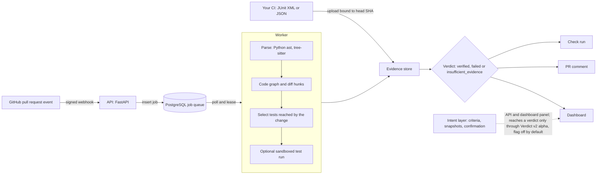

# Radius

[](https://github.com/Mohith-c7/Radius/actions/workflows/ci.yml)
[](https://github.com/Mohith-c7/Radius/actions/workflows/security.yml)

**A green CI check doesn't always mean your change was tested. Radius tells you whether it actually was.**

Tests can pass without ever touching the code a pull request changed, and pull requests keep getting bigger than anyone can read line by line. Radius looks at what a pull request changes, follows that change through the code to everything it can affect, and picks the tests that cover it. Once your CI has run those tests, Radius gives you a clear answer, **verified**, **failed** or **not enough evidence**, and shows you why. If the evidence isn't there, it says so instead of guessing.


> **Early days.** Radius is an alpha (`0.1.0`) built as a capstone project. There are no releases yet, the 0–100 score is a rough heuristic rather than a probability, and it hasn't been run against a real GitHub installation. Details in [Known limitations](docs/KNOWN_LIMITATIONS.md).

## How it works

Radius reads a pull request, works out every part of the code the change can reach, and picks only the tests that cover it.
When your CI uploads the results of those tests, Radius tells you whether the PR is safe to merge, and shows the evidence behind it.


<details>
<summary>Architecture diagram (components and data flow)</summary>



More in [System architecture](docs/SYSTEM_ARCHITECTURE.md).

</details>

## A tour of the dashboard

| | |
|---|---|
|  | **Overview.** Your repositories, recent analyses and overall confidence on one page. |
|  | **Add a PR.** Paste a link to any public GitHub pull request, and Radius analyses it with no setup. |
|  | **The verdict.** One pull request's result, its score and the exact reasons behind it. |
|  | **Impact map.** Every file the change reaches, from the edited files on the left to the tests that cover them on the right. |
|  | **Why it's affected.** Click any file to see the chain of imports that connects it to the change. |
|  | **Tests that matter.** Only the relevant tests are selected, each with the reason it was picked. |
|  | **Compare changes.** Switch between analyses to see how far different pull requests ripple. |
|  | **Contained changes.** When nothing else depends on the edited code, Radius says the change stays local. |

## Try it locally

You need Docker with Compose v2. The first build takes a few minutes; after that it starts quickly.

```bash
git clone https://github.com/Mohith-c7/Radius.git && cd Radius
make dev                          # Linux, macOS, WSL, Git Bash
# Windows PowerShell without make:  .\scripts\dev.ps1 dev
```

`make dev` creates a `.env` with random secrets and starts the database, the API, the worker and the dashboard. When it's ready, open:

| What | Where |
|---|---|
| Dashboard | http://localhost:3000 |
| API docs | http://localhost:8000/docs |
| Health check | http://localhost:8000/api/v1/health |

Then:

1. **Sign up** with any e-mail address. In development mode the account is verified straight away.
2. **Analyze a pull request.** Go to *Repositories → Add repository or PR*, paste a link to a public GitHub PR and click *Analyze PR*. The result shows up in a minute or two.
3. **Want sample data?** `make seed-demo` adds illustrative demo analyses and a demo login (`demo@radius.dev`). Only use it on a throwaway database.
4. **Done?** `make down` stops everything; `make clean-volumes` also deletes the database.

Prefer your own PostgreSQL (Neon, Aiven, a server) and no Docker? Follow [Run against your own Postgres](docs/DEVELOPMENT_GUIDE.md#run-against-your-own-postgres-three-terminals-no-docker). Don't expose the development setup to a network. For a real deployment or a GitHub App, see the [deployment guide](docs/DEPLOYMENT.md); to use the verdict as a CI gate, see the [CI integration guide](docs/CI_INTEGRATION_GUIDE.md).

## What works today

| | Status | In plain words |
|---|---|---|
| Python and TypeScript/JavaScript | beta | Radius reads the code, follows imports between files and builds a dependency graph. |
| Go, Java, Rust | experimental | Radius reads the code but doesn't follow imports yet, so it only sees the changed files. |
| Test selection | beta | Picks the tests the change can reach; runs the full suite when it can't tell. |
| The verdict | beta | Built from your CI's test results for the exact commit analysed. Missing evidence never counts as a pass. |
| Impact map | beta | Shows how a change spreads, file by file, and why each file is affected. |
| Analyze a public PR from its link | beta | No GitHub App needed. Private repositories still need the App. |
| Score (0–100) | experimental | A rough heuristic to help you scan, not a probability. |
| GitHub App (check runs, PR comments) | alpha | Tested only against a fake GitHub so far. |
| Verdict v2 (per-requirement verdict) | alpha, off by default | Checks each stated requirement of a PR separately. Python only. [How to read it](docs/verdict-v2.md). |
| Running tests in a sandbox | experimental | Off by default. Radius normally uses the results your CI uploads. |

The full picture, with every limitation and where it's tracked, is in [Known limitations](docs/KNOWN_LIMITATIONS.md).

## What Radius is not

- **Not a replacement** for your CI or your code reviewers. It sits next to them.
- **Not a proof** that the code is correct. It tells you how good the evidence is.
- **Not a test runner** by default. It works from the results your CI produces.
- **Not new in every part.** Other tools map PRs to evidence or reason about weak tests; what Radius explores is putting those together at pull-request time ([novelty assessment](docs/research/literature/novelty-assessment.md)). The research side of the project lives in [docs/research](docs/research/README.md); those are open questions, not results.

## Documentation

- [Development guide](docs/DEVELOPMENT_GUIDE.md): setup, hot reload, Windows notes, branch flow
- [Operations](docs/operations/README.md): install, configuration, upgrades, backups, hardening
- [Deployment](docs/DEPLOYMENT.md) and [CI integration](docs/CI_INTEGRATION_GUIDE.md)
- [System architecture](docs/SYSTEM_ARCHITECTURE.md), [API contracts](docs/API_CONTRACTS.md), [observability](docs/OBSERVABILITY.md)
- [Product vision](docs/PRODUCT_VISION.md), [roadmap](docs/roadmap.md), [decisions](docs/decisions.md)
- [Production readiness](docs/production-readiness/README.md), [known limitations](docs/KNOWN_LIMITATIONS.md), [release checklist](docs/RELEASE_CHECKLIST.md)
- [Verdict v2](docs/verdict-v2.md), [policy](docs/policy.md), [threat model](docs/security/VERDICT_V2_THREAT_MODEL.md), [CI checks](docs/security/CI_CHECKS.md)
- [Changelog](CHANGELOG.md)

The code is organised as `apps/` (API, worker, dashboard), `packages/` (the analysis building blocks), `infra/` (database migrations, observability), plus `docs/`, `tests/` and `benchmarks/`.

## Contributing

Contributions are welcome. Please read [CONTRIBUTING.md](CONTRIBUTING.md) first (workflow, tests and the DCO sign-off) and our [Code of Conduct](CODE_OF_CONDUCT.md). Found a security issue? Report it privately as described in [SECURITY.md](SECURITY.md).

## License

Apache License 2.0. See `LICENSE` and `NOTICE`, and [third-party notices](THIRD_PARTY_NOTICES.md). Contributions use a DCO sign-off, not a CLA.

## Citation

There's no paper or DOI yet. A `CITATION.cff` will come with the first release. Until then, see the [pre-registration draft](docs/research/preregistration/PREREGISTRATION.md) and [datasets](docs/research/datasets/INVENTORY.md).
