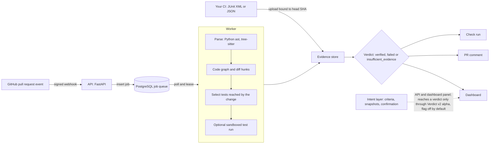

# Radius

[](https://github.com/Mohith-c7/Radius/actions/workflows/ci.yml)
[](https://github.com/Mohith-c7/Radius/actions/workflows/security.yml)

**Radius tells you whether a pull request has been verified, by evidence, or only looks green.**

CI can pass while the tests that ran never touched the change, and AI-assisted code makes pull requests larger than people can read closely. Radius analyses the pull request as a change to a dependency graph, selects the tests that can reach it, and returns a verdict that is computed from the test results it receives: `verified`, `failed`, or `insufficient_evidence`. It never turns missing evidence into a pass.

> **Project status.** Radius is pre-1.0 (version `0.1.0`), an **alpha** built as a capstone project. There are no published releases, images or packages. Its numbers come from a small self-evaluation, and the 0-100 score is an uncalibrated heuristic, not a probability. Licensed under Apache-2.0 (see [License](#license)).

## Status: what was verified, what is alpha, what is not done

Last checked by running the product: 2026-11-03. Only the items in the first list were actually run.

**Verified by running it**

- The local development stack (`make dev`, which layers `docker-compose.dev.yml`) builds and its four services (migrations, api, worker, dashboard) become healthy, with PostgreSQL.
- In Chrome: sign-up (auto-verified in dev mode), the dashboard pages, demo sign-in, a seeded demo analysis page, and a real analysis with the Verdict v2 panel rendered (alpha banner, per-criterion states, "why this verdict" rules, CI evidence, dependency graph).
- Confirming an intent criterion in the dashboard stores a new verdict revision within seconds and clears that criterion's "unconfirmed" flag (DEC-033).
- The end-to-end smoke test (real API, real worker, PostgreSQL, a fake GitHub) passes on the Linux CI runner. On develop, CI, Coverage, Security, CodeQL, Smoke and Scorecard (7.4) are green.

**Alpha (works in the cases above, not trusted beyond them)**

- Verdict v2 is off by default and must be turned on explicitly. It uses static assertion strength only, is uncalibrated, covers Python only, and part of its evidence is controlled by the PR author.
- The v1 verdict, test selection, intent layer, tamper rules and linking are tested in CI but evaluated only on small or synthetic corpora.

**Not verified or not done**

- Anything against real GitHub (webhooks, GitHub App installation, check runs and comments on a real repository). Only a fake GitHub has been exercised.
- A production-mode run (`docker compose up` without the dev override), the sandbox on Windows, and signed releases (not built). SSO is not built.
- Mutation scores in the worker (research spike only), calibration, and a second gold-set annotator.
- In the browser: the "Re-run analysis" button, and the intent-upload and JUnit-upload buttons. TypeScript typecheck, lint and build of the dashboard were not re-run in the verification session.

The full list with mitigations and where each item is tracked is in [docs/KNOWN_LIMITATIONS.md](docs/KNOWN_LIMITATIONS.md). The go/no-go list for a first alpha release is [docs/RELEASE_CHECKLIST.md](docs/RELEASE_CHECKLIST.md).

## What Radius is and is not

- It is **static evidence**. Verdicts come from the graph of the change, the test results your CI uploads, and the shape of the test code (for example whether a test asserts anything). Radius does not execute your tests by default.
- It is **uncalibrated**. Thresholds were fitted to a handful of fixtures (8 in the Verdict v2 replay). Scores and states are not probabilities and have no measured error rate.
- It is **not a proof** of correctness. "Supported" means the available evidence looks adequate for a stated criterion; the PR author can influence some of that evidence, and the Verdict v2 Check Run is advisory by default.
- It does **not replace** your CI or code review, and it abstains (`insufficient_evidence`) rather than passing when evidence is missing.

## How it works



The intent layer (what a change is supposed to do, as confirmable criteria with provenance) exists as a package, API and dashboard panel through milestone M1. It does not feed the default (v1) verdict or the PR comment. The opt-in Verdict v2 alpha (`RADIUS_FEATURE_VERDICT_V2`, off by default) is the only path that uses it. Details: [System architecture](docs/SYSTEM_ARCHITECTURE.md).

## Quickstart (local, about 5 minutes after the first build)

This is the path that was run and checked on 2026-11-03. It needs Docker with Compose v2. The first image build takes several minutes; later starts are faster. Never expose this development profile to a network.

```bash
git clone https://github.com/Mohith-c7/Radius.git && cd Radius
make dev                          # Linux, macOS, WSL, Git Bash
# Windows PowerShell without make:  .\scripts\dev.ps1 dev
```

`make dev` generates a `.env` with random secrets and starts PostgreSQL, migrations, the api, the worker and the dashboard in development mode (auto-verified accounts, sign-in links also printed in `make logs`). It waits until all services are healthy.

| What | URL |
|---|---|
| Dashboard | http://localhost:3000 |
| API docs | http://localhost:8000/docs |
| Health | http://localhost:8000/api/v1/health |

1. **Sign up** in the dashboard with any e-mail address; in dev mode the account is verified immediately.
2. **Load demo data** (optional, disposable database only): `make seed-demo` (Windows: `.\scripts\dev.ps1 seed-demo`, which needs `uv`). It adds hand-written illustrative fixtures and a demo login (`demo@radius.dev`, publicly documented password). It is not real analysis output. See the [development guide](docs/DEVELOPMENT_GUIDE.md).
3. **Turn on Verdict v2** (off by default). Set `RADIUS_FEATURE_VERDICT_V2=on` in `.env`; the intent-aware result also needs `RADIUS_FEATURE_INTENT_INGESTION=true` (see `.env.example`). Then run `make dev` again so the api and worker are recreated with the new value.
4. Stop with `make down`; `make clean-volumes` also deletes the database.

What this does **not** do: connect a GitHub repository. For that, create a GitHub App and follow the [deployment guide](docs/DEPLOYMENT.md) and the [GitHub App validation runbook](docs/github-app-validation/RUNBOOK.md); that path has not been run against real GitHub. Plain `docker compose up` is production-like, needs real secrets, keys and https origins ([INSTALL](docs/operations/INSTALL.md)), and was not run. To use the verdict as a CI gate see the [CI integration guide](docs/CI_INTEGRATION_GUIDE.md).

## What works today

Maturity: **stable** = covered by tests and CI, used end to end; **beta** = works, covered by tests, rough edges or limited validation; **experimental** = exists, may be wrong or incomplete, do not depend on it; **planned** = not built.

| Capability | Maturity | Notes and evidence |
|---|---|---|
| Python parsing and code graph | beta | Standard-library `ast`. Cross-file imports resolved to a dependency graph. |
| TypeScript / JavaScript parsing | beta | tree-sitter; relative, extension/index and `tsconfig` `baseUrl`/`paths` resolution. Package `exports` and workspace package names are not resolved. |
| Go, Java, Rust parsing | experimental | tree-sitter symbols only; imports are not resolved to files, so no dependency edges. |
| Diff-hunk and symbol-level impact | beta | Python only, conservative; behind `RADIUS_FEATURE_SYMBOL_IMPACT` ([docs](docs/MODULE_ARCHITECTURE.md)). |
| Graph-driven test selection | beta | Falls back to the full suite when the graph cannot map the change. Measured on a small self-evaluation corpus only: [benchmark](docs/benchmarks/REAL_REPO_BENCHMARK.md). |
| Evidence-gated verdict | beta | Uploads are bound to the analysed head commit and must cover the selected tests; the verdict is recomputed from all uploads. |
| Verdict v2: per-criterion verdict (`RADIUS_FEATURE_VERDICT_V2`) | alpha, off by default | Per-criterion support from static assertion strength ("supported", not a proof of correctness), unsupported-intent mass, tamper rules; one PR comment and an advisory Check Run (`neutral` by default) updated after CI uploads; modes `off`, `shadow`, `on`. Uncalibrated (tamper severities are assumptions; in the [re-run on 29 of this repository's PRs](docs/research/evaluation/REPLAY_2026-11-rerun.md) 2 PRs were `failed` by a tamper finding in the default mode, at least one overstated, and the tamper output varied between runs under load), Python-only; the PR author controls part of the evidence (hints are capped): [how to read it](docs/verdict-v2.md), [threat model](docs/security/VERDICT_V2_THREAT_MODEL.md). |
| Confidence score (0-100) | experimental | Uncalibrated heuristic, labelled `heuristic_uncalibrated` everywhere it is shown. |
| GitHub App: check run, PR comment | alpha, never run against live GitHub | Verified only against an in-memory fake GitHub (smoke test in CI). The v1 check run is published at completion and is not re-published after later CI uploads; Verdict v2 does republish. A webhook-free path (connect a repo, sync or analyze a PR) exists: [live demo guide](docs/operations/LIVE_GITHUB_DEMO.md); older [runbook](docs/github-app-validation/RUNBOOK.md). |
| PostgreSQL job queue and worker | beta | Durable jobs, leases and retries; no Redis. |
| Sandboxed test execution | experimental | Off by default (`WORKER_TEST_EXECUTION_MODE=disabled`); fails closed. See [isolation notes](docs/security/EXECUTION_ISOLATION.md). Penetration test not done. |
| Flaky-test handling | experimental | Off by default: `WORKER_TEST_RERUNS=0` means no rerun and so no flaky detection, and it needs sandbox execution. When reruns are on, a test that fails then passes is flaky: with the default `WORKER_FLAKY_POLICY=exclude` it counts as neither pass nor fail and blocks `verified` (verdict `insufficient_evidence`); `fail` counts it as a failure. It is never counted as a pass ([docs](docs/FLAKY_TESTS.md)). |
| Dashboard (graph, test hub, report ingestion) | beta | Next.js. A headless-browser e2e (sign-up and the main pages) runs in CI; no accessibility audit yet. |
| Intent layer (M1) | beta | Criteria extraction (deterministic; optional guarded LLM, off by default), testability rating, versioned snapshots, API, dashboard confirmation panel. Source ingestion from GitHub (PR body, linked issues, commits, `.radius/intent.yml`) exists but is off by default (`RADIUS_FEATURE_INTENT_INGESTION`) and has not been validated against a live installation; otherwise sources are submitted through the API. Not in the default verdict. By default (`sections` mode) extraction finds no criteria in ordinary PR descriptions (0 of 29 PRs of this repository's history); opt-in `summary` and `llm` modes propose criteria that a human must confirm ([limitations](docs/KNOWN_LIMITATIONS.md)). |
| Criterion-to-symbol and symbol-to-test linking | experimental | `packages/linking` and the linkers in `packages/testing` are libraries with reason codes and chain confidence. The worker calls them only inside the Verdict v2 alpha (`RADIUS_FEATURE_VERDICT_V2`); the dynamic coverage-context linker also needs `RADIUS_FEATURE_COVERAGE_CONTEXTS` and sandbox execution. Evaluated on synthetic fixtures only. |
| Symbol changes, tamper rules, assertion extraction | experimental | Each is a flagged-off analysis step (`RADIUS_FEATURE_SYMBOL_CHANGES`, `RADIUS_FEATURE_TAMPER_RULES`, `RADIUS_FEATURE_ASSERTION_EXTRACTION`, all default false) that logs counts and changes no v1 output. Tamper rules are a Python-first deterministic catalog ([docs](docs/evidence/TAMPER_RULES.md)). Their results are used by the Verdict v2 alpha. |
| LLM semantic pruning (Gemini) | experimental, legacy | Not called by the analysis pipeline; no model output can remove tests. If you enable it by hand (`RADIUS_FEATURE_GEMINI_PRUNER=true` plus `GEMINI_API_KEY`) it sends caller source code and diffs to Google Gemini and is outside the LLM egress policy (DEC-021). Leave both unset. |
| Mutation-based evidence strength, calibration, process verification | planned | Research plan, not code: [implementation plan](docs/research/IMPLEMENTATION_PLAN.md). The Verdict v2 alpha uses static assertion strength only. |
| CLI, published GitHub Action, MCP server, Helm chart, container images, SSO | planned | A local composite action exists at `.github/actions/radius-verify`. Nothing is published. |

## What is research

Radius also hosts a research programme on intent-to-evidence verification: whether a verdict can say which stated criteria are proven by evidence that would have caught a failure. The hypotheses, evaluation design and pre-registration draft are in [docs/research](docs/research/README.md). They are hypotheses, not results; no claim from that programme is supported yet.

## How it differs from alternatives

Only what the [novelty assessment](docs/research/literature/novelty-assessment.md) supports, and that review was not systematic:

- Mapping pull-request criteria to evidence is **not new**: AgentProof and ScopeProof do versions of it. Radius does not claim it.
- Mutation-style reasoning about weak tests is **not new**: SWE-ABS, UTBoost and PatchDiff use it to build better benchmark labels.
- What Radius investigates is the combination: criterion-linked evidence, fault-detection-weighted strength and calibrated abstention, scored at pull-request time without a gold patch. That is a research question that is still open, not a shipped feature.
- What ships today is narrower: graph-driven test selection and an evidence-gated verdict that abstains instead of passing when evidence is missing. It replaces neither your CI nor your reviewers.

## Documentation

- [Development guide](docs/DEVELOPMENT_GUIDE.md): one-command stack, hot reload, Windows notes, branch flow.
- [Operator documentation](docs/operations/README.md): install, configuration reference, upgrade, backup, hardening, runbook
- [Deployment](docs/DEPLOYMENT.md) and [CI integration](docs/CI_INTEGRATION_GUIDE.md)
- [System architecture](docs/SYSTEM_ARCHITECTURE.md), [API contracts](docs/API_CONTRACTS.md), [observability](docs/OBSERVABILITY.md)
- [Product vision](docs/PRODUCT_VISION.md), [roadmap](docs/roadmap.md), [decisions](docs/decisions.md)
- [Production-readiness audit and backlog](docs/production-readiness/README.md): what is missing before 1.0, including the v1.0 definition of done
- [Known limitations](docs/KNOWN_LIMITATIONS.md) and [alpha release checklist](docs/RELEASE_CHECKLIST.md)
- [Verdict v2: how to read it](docs/verdict-v2.md), [policy](docs/policy.md), [threat model](docs/security/VERDICT_V2_THREAT_MODEL.md), [CI checks](docs/security/CI_CHECKS.md)
- [Changelog](CHANGELOG.md)

Repository layout: `apps/` (api, worker, dashboard), `packages/` (analysis, confidence, evidence, github, graph, intent, linking, parser, repository, shared, testing), `infra/` (migrations, observability), `docs/`, `tests/`, `benchmarks/`.

## Contributing and security

See [CONTRIBUTING.md](CONTRIBUTING.md) (workflow, tests, DCO sign-off), [CODE_OF_CONDUCT.md](CODE_OF_CONDUCT.md) and [SECURITY.md](SECURITY.md) for private vulnerability reporting.

## License

Radius is licensed under the Apache License 2.0 (`LICENSE`, `NOTICE`; decision DEC-018 in [docs/decisions.md](docs/decisions.md)). Contributions use a DCO sign-off, not a CLA. Third-party notices: [THIRD_PARTY_NOTICES.md](THIRD_PARTY_NOTICES.md).

## Citation

No paper or DOI exists yet. Pre-registration draft and datasets: [docs/research/preregistration](docs/research/preregistration/PREREGISTRATION.md), [docs/research/datasets](docs/research/datasets/INVENTORY.md). A `CITATION.cff` will be added with the first release (PRD-31).
