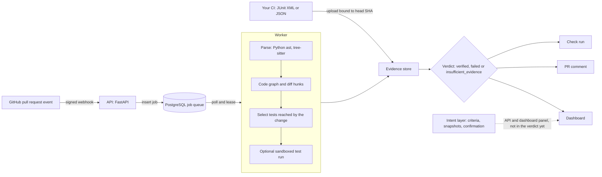

# Radius

[](https://github.com/Mohith-c7/Radius/actions/workflows/ci.yml)
[](https://github.com/Mohith-c7/Radius/actions/workflows/security.yml)

**Radius tells you whether a pull request has been verified, by evidence, or only looks green.**

CI can pass while the tests that ran never touched the change, and AI-assisted code makes pull requests larger than people can read closely. Radius analyses the pull request as a change to a dependency graph, selects the tests that can reach it, and returns a verdict that is computed from the test results it receives: `verified`, `failed`, or `insufficient_evidence`. It never turns missing evidence into a pass.

> **Project status and honesty.** Radius is pre-1.0 (version `0.1.0`) and was built as a capstone project. It has no published releases, and its numbers come from a small self-evaluation. The 0-100 score is an uncalibrated heuristic, not a probability. The licence is **pending** (see [Licence](#licence)). Anything labelled experimental or planned below is not something to rely on.

## How it works



The intent layer (what a change is supposed to do, as confirmable criteria with provenance) exists as a package, API and dashboard panel through milestone M1. It does not feed the verdict or the PR comment yet. Details: [System architecture](docs/SYSTEM_ARCHITECTURE.md).

## Quickstart

Needs Docker with Compose v2. The first build takes several minutes (about 10 on a cold cache in the reference run, see the [development guide](docs/DEVELOPMENT_GUIDE.md)); later starts take under a minute.

```bash
git clone https://github.com/Mohith-c7/Radius.git && cd Radius
make dev                          # Linux, macOS, WSL, Git Bash
# Windows PowerShell without make:  .\scripts\dev.ps1 dev
```

| What | URL |
|---|---|
| Dashboard | http://localhost:3000 |
| API docs | http://localhost:8000/docs |
| Health | http://localhost:8000/api/v1/health |

Stop with `make down`. This brings up PostgreSQL, migrations, the API, the worker and the dashboard. It does **not** connect a GitHub repository: for that, create a GitHub App and set the webhook and key variables, following the [deployment guide](docs/DEPLOYMENT.md) and the [GitHub App validation runbook](docs/github-app-validation/RUNBOOK.md). For a look at the UI with illustrative (not real) data on a disposable database, run `make seed-demo`. To run your tests with the verdict as a CI gate, see the [CI integration guide](docs/CI_INTEGRATION_GUIDE.md).

## What works today

Maturity: **stable** = covered by tests and CI, used end to end; **beta** = works, covered by tests, rough edges or limited validation; **experimental** = exists, may be wrong or incomplete, do not depend on it; **planned** = not built.

| Capability | Maturity | Notes and evidence |
|---|---|---|
| Python parsing and code graph | beta | Standard-library `ast`. Cross-file imports resolved to a dependency graph. |
| TypeScript / JavaScript parsing | beta | tree-sitter; relative, extension/index and `tsconfig` `baseUrl`/`paths` resolution. Package `exports` and workspace package names are not resolved. |
| Go, Java, Rust parsing | experimental | tree-sitter symbols only; imports are not resolved to files, so no dependency edges. |
| Diff-hunk and symbol-level impact | beta | Python only, conservative; behind `RADIUS_FEATURE_SYMBOL_IMPACT` ([docs](docs/MODULE_ARCHITECTURE.md)). |
| Graph-driven test selection | beta | Falls back to the full suite when the graph cannot map the change. Measured on a small self-evaluation corpus only: [benchmark](docs/benchmarks/REAL_REPO_BENCHMARK.md). |
| Evidence-gated verdict | beta | Uploads are bound to the analysed head commit and must cover the selected tests; the verdict is recomputed from all uploads. |
| Verdict v2: per-criterion verdict (`RADIUS_FEATURE_VERDICT_V2`) | alpha, off by default | Per-criterion support from static assertion strength ("supported", not a proof of correctness), unsupported-intent mass, tamper rules; one PR comment and an advisory Check Run (`neutral` by default) updated after CI uploads; modes `off`, `shadow`, `on`. Uncalibrated, Python-only; the PR author controls part of the evidence (hints are capped): [how to read it](docs/verdict-v2.md), [threat model](docs/security/VERDICT_V2_THREAT_MODEL.md). |
| Confidence score (0-100) | experimental | Uncalibrated heuristic, labelled `heuristic_uncalibrated` everywhere it is shown. |
| GitHub App: check run, PR comment | beta | Check run is published at completion and is not re-published after later CI uploads; the CI job exit code is the gate for uploaded evidence. Live validation: [runbook](docs/github-app-validation/RUNBOOK.md). |
| PostgreSQL job queue and worker | beta | Durable jobs, leases and retries; no Redis. |
| Sandboxed test execution | experimental | Off by default (`WORKER_TEST_EXECUTION_MODE=disabled`); fails closed. See [isolation notes](docs/security/EXECUTION_ISOLATION.md). Penetration test not done. |
| Flaky-test handling | beta | A flaky test is treated as a failure, never a pass ([docs](docs/FLAKY_TESTS.md)). |
| Dashboard (graph, test hub, report ingestion) | beta | Next.js. No browser end-to-end or accessibility audit yet. |
| Intent layer (M1) | beta | Criteria extraction (deterministic; optional guarded LLM, off by default), testability rating, versioned snapshots, API, dashboard confirmation panel. Sources are submitted through the API; automatic ingestion from the PR is not built. Not in the verdict. |
| LLM semantic pruning | experimental | Not on the verdict path; no model output can remove tests. |
| Criterion-to-evidence linking, mutation-based evidence strength, calibration | planned | Research plan, not code: [implementation plan](docs/research/IMPLEMENTATION_PLAN.md). |
| CLI, published GitHub Action, MCP server, Helm chart, container images, SSO | planned | A local composite action exists at `.github/actions/radius-verify`. Nothing is published. |

## What is research

Radius also hosts a research programme on intent-to-evidence verification: whether a verdict can say which stated criteria are proven by evidence that would have caught a failure. The hypotheses, evaluation design and pre-registration draft are in [docs/research](docs/research/README.md). They are hypotheses, not results; no claim from that programme is supported yet.

## How it differs from alternatives

Only what the [novelty assessment](docs/research/literature/novelty-assessment.md) supports, and that review was not systematic:

- Mapping pull-request criteria to evidence is **not new**: AgentProof and ScopeProof do versions of it. Radius does not claim it.
- Mutation-style reasoning about weak tests is **not new**: SWE-ABS, UTBoost and PatchDiff use it to build better benchmark labels.
- What Radius investigates is the combination: criterion-linked evidence, fault-detection-weighted strength and calibrated abstention, scored at pull-request time without a gold patch. That is a research question that is still open, not a shipped feature.
- What ships today is narrower: graph-driven test selection and an evidence-gated verdict that abstains instead of passing when evidence is missing. It replaces neither your CI nor your reviewers.

## Documentation

- [Development guide](docs/DEVELOPMENT_GUIDE.md): one-command stack, hot reload, Windows notes, branch flow.
- [Deployment](docs/DEPLOYMENT.md) and [CI integration](docs/CI_INTEGRATION_GUIDE.md)
- [System architecture](docs/SYSTEM_ARCHITECTURE.md), [API contracts](docs/API_CONTRACTS.md), [observability](docs/OBSERVABILITY.md)
- [Product vision](docs/PRODUCT_VISION.md), [roadmap](docs/roadmap.md), [decisions](docs/decisions.md)
- [Production-readiness audit and backlog](docs/production-readiness/README.md): what is missing before 1.0, including the v1.0 definition of done
- [Changelog](CHANGELOG.md)

Repository layout: `apps/` (api, worker, dashboard), `packages/` (analysis, confidence, github, graph, intent, parser, repository, shared, testing), `infra/` (migrations, observability), `docs/`, `tests/`, `benchmarks/`.

## Contributing and security

See [CONTRIBUTING.md](CONTRIBUTING.md) (workflow, tests, DCO sign-off), [CODE_OF_CONDUCT.md](CODE_OF_CONDUCT.md) and [SECURITY.md](SECURITY.md) for private vulnerability reporting.

## License

Radius is licensed under the Apache License 2.0 (`LICENSE`, `NOTICE`; decision DEC-018 in [docs/decisions.md](docs/decisions.md)). Contributions use a DCO sign-off, not a CLA. Third-party notices: [THIRD_PARTY_NOTICES.md](THIRD_PARTY_NOTICES.md).

## Citation

No paper or DOI exists yet. Pre-registration draft and datasets: [docs/research/preregistration](docs/research/preregistration/PREREGISTRATION.md), [docs/research/datasets](docs/research/datasets/INVENTORY.md). A `CITATION.cff` will be added with the first release (PRD-31).
