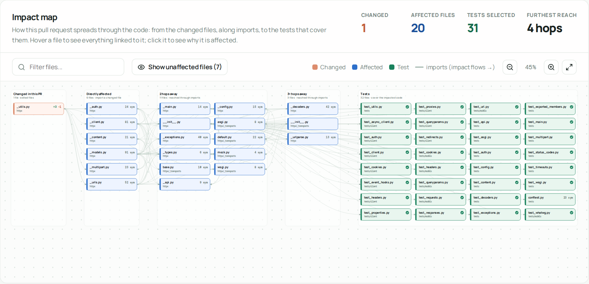
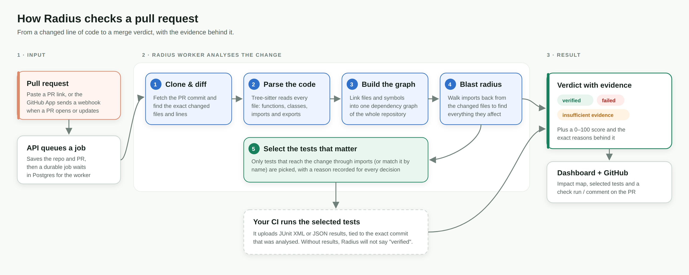
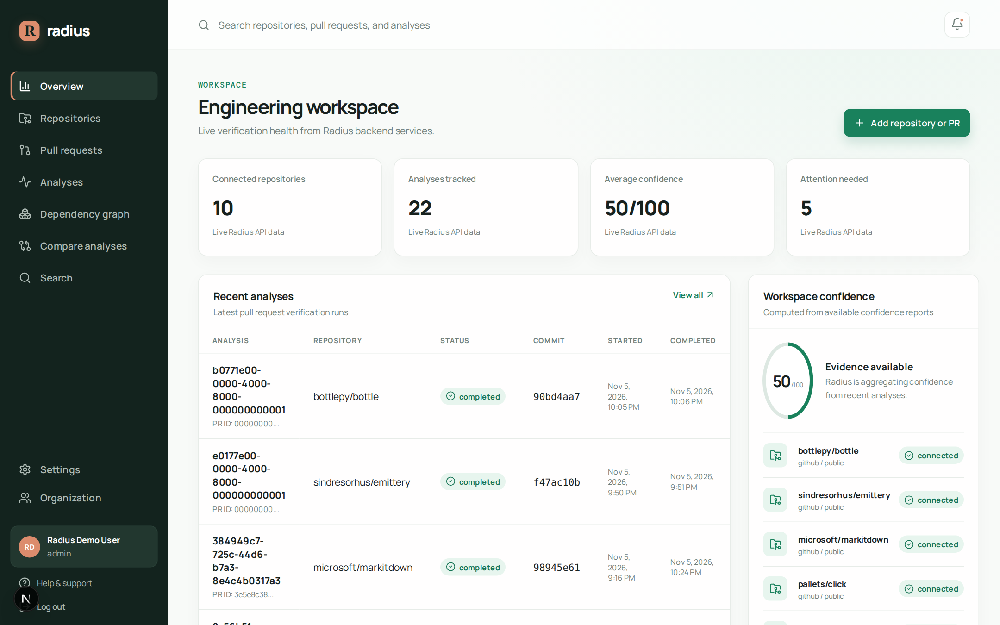
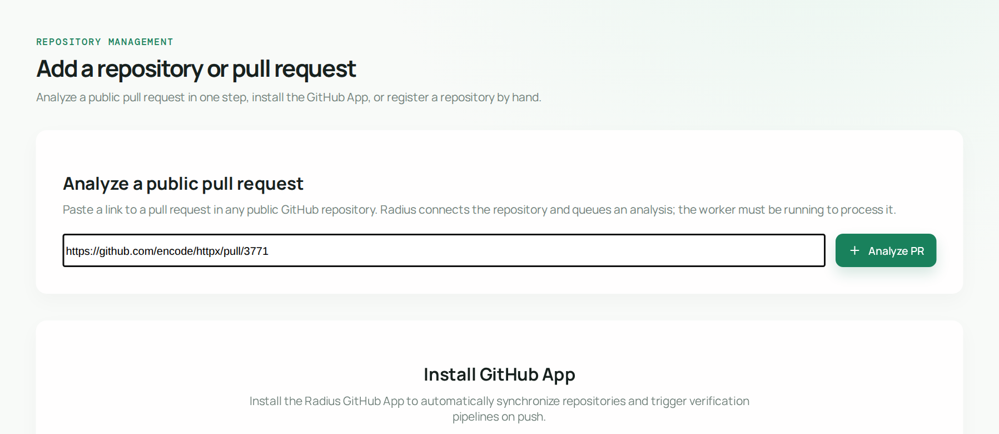
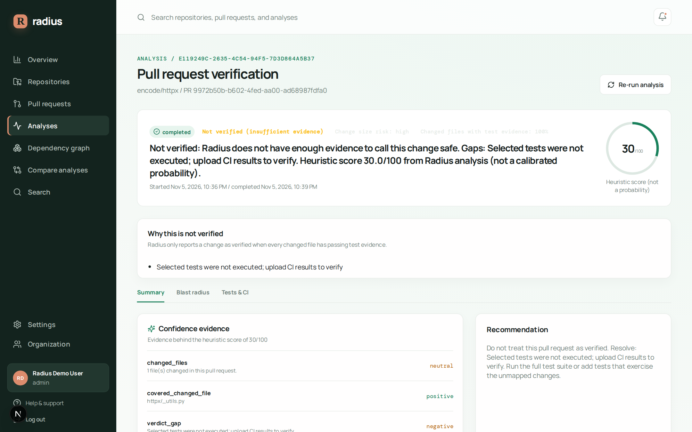
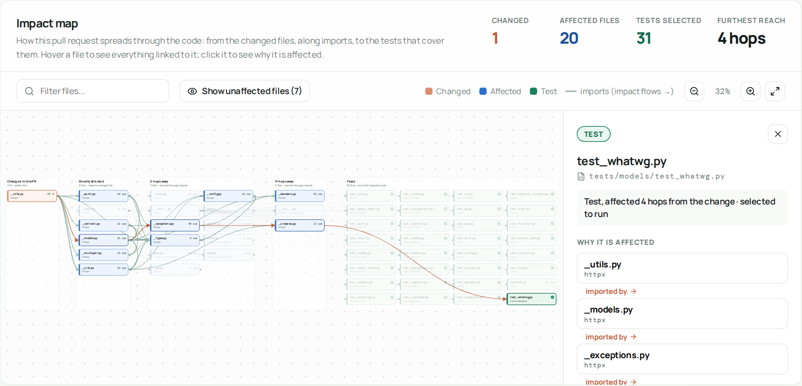
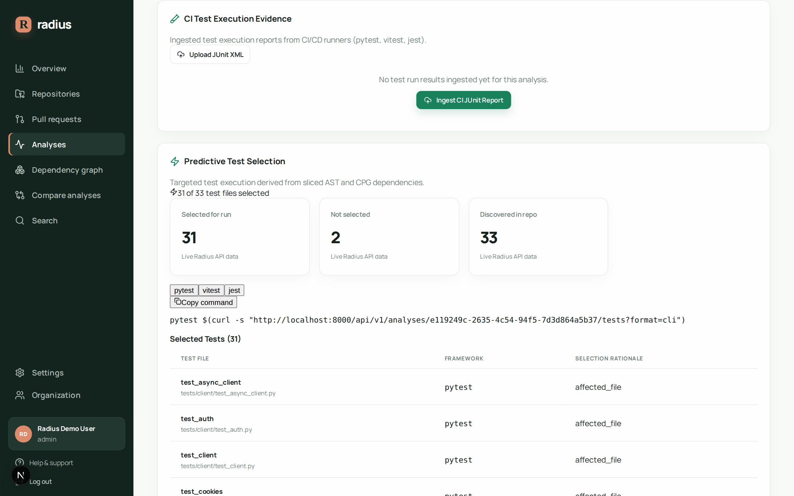
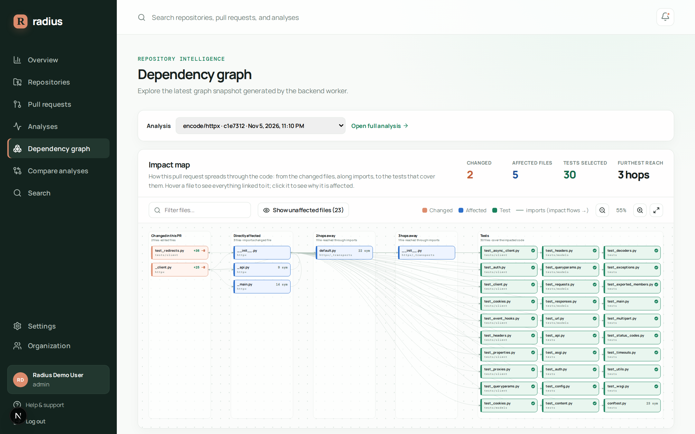
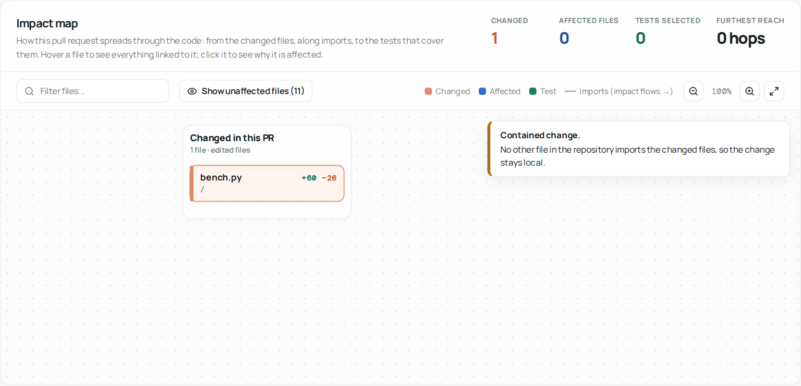

# Radius

> The AI-native confidence layer for modern software development.

Radius is an AI-native software verification platform that helps engineering teams understand whether a pull request is safe to merge.

Radius does not replace existing test frameworks, CI/CD systems, or code editors. It sits between code changes and production deployment, analyzes the repository as an interconnected system, and produces explainable verification evidence before merge.




---

## How It Works

Radius reads a pull request, works out every part of the code the change can reach, and picks only the tests that cover it.
When your CI uploads the results of those tests, Radius gives a verdict on whether the PR is safe to merge, and shows the evidence behind it.



---

## A Tour of the Dashboard

| | |
|---|---|
|  | **Overview.** Your repositories, recent analyses and overall confidence on one page. |
|  | **Add a PR.** Paste a link to any public GitHub pull request, and Radius analyses it with no setup. |
|  | **The verdict.** One pull request's result, its score and the exact reasons behind it. |
|  | **Impact map.** Every file the change reaches, from the edited files on the left to the tests that cover them on the right. |
|  | **Why it's affected.** Click any file to see the chain of imports that connects it to the change. |
|  | **Tests that matter.** Only the relevant tests are selected, each with the reason it was picked. |
|  | **Compare changes.** Switch between analyses to see how far different pull requests ripple. |
|  | **Contained changes.** When nothing else depends on the edited code, Radius says the change stays local. |

To run it yourself, see [Running Locally](docs/DEVELOPMENT_GUIDE.md#running-locally).

---

## The Core Question

Every subsystem in Radius contributes to one fundamental question:

```text
Can this Pull Request be merged safely?
```

---

## Key Capabilities

1. **Multi-Language Code Property Graph (CPG)**:
   - Tree-Sitter AST extraction for **Python** and **TypeScript / JavaScript**.
   - Resolves cross-file symbol references and import statements into a directed dependency graph.
2. **Diff-Hunk Line Precision**:
   - Parses unified git diff hunks to identify exact modified line numbers.
   - Slices only symbols directly affected by modified lines, skipping untouched sibling functions in edited files.
3. **Gemini Semantic Analysis (experimental, advisory only)**:
   - A proof-of-concept LLM call-site classifier exists, but it is **not** on the verdict path: no model output can remove tests or dependency edges from the selection (see `docs/audit/RADIUS_AUDIT.md`, P0-8).
4. **Dependency-Graph Test Selection**:
   - Selects test files that reach a changed file through the file-level import graph, plus naming-convention matches (`pytest`, `vitest`, `jest`).
   - Executes only the tests the dependency graph reaches from the change (with a full-suite fallback when the graph cannot map it). No general time-saving figure is claimed; measured selection/time numbers on a small self-evaluation corpus are in [docs/benchmarks/REAL_REPO_BENCHMARK.md](docs/benchmarks/REAL_REPO_BENCHMARK.md).
   - Generates multi-framework CLI strings directly executable in local or CI runners.
5. **Universal CI Ingestion & Dynamic Confidence Engine**:
   - Ingests standard **JUnit XML** and **JSON** test execution reports from any CI runner.
   - Uploads are bound to the analysed head commit and must cover the selected tests; the evidence-gated verdict (`verified` / `failed` / `insufficient_evidence`) is recomputed from all uploads. The 0-100 score is a heuristic, not a calibrated probability.
6. **Rich GitHub App Integration**:
   - Publishes `Radius confidence` Check Runs with `in_progress` status on webhook arrival and `completed` status upon verification.
   - Formats GitHub PR comments with the verdict, the reasons a change is not verified, and collapsible blast radius tables. The Check Run is published when the analysis completes; it is not yet re-published after CI uploads (the CI job's exit code is the merge gate for uploaded evidence).
7. **Interactive Next.js Dashboard**:
   - Impact map: a file-level view of each pull request (changed files → files they reach → tests), with the import chain that explains why each file is affected, pan/zoom and a file inspector. Import links are traced for Python today.
   - Analyze any public GitHub pull request from its link, without installing the GitHub App.
   - Test Selection Hub with 1-click CLI runner command copy.
   - Ingestion modal for pasting or uploading JUnit XML and JSON test reports with live confidence refreshes.

---

## Quickstart: Docker Compose

Spin up the entire Radius production stack with PostgreSQL, Redis, API, Worker, and Next.js Dashboard:

```bash
# Clone the repository
git clone https://github.com/Mohith-c7/Radius.git
cd Radius

# Configure environment
cp .env.example .env.production

# Run all services
docker compose --env-file .env.production up -d --build
```

- **Next.js Dashboard**: `http://localhost:3000`
- **FastAPI API**: `http://localhost:8000/api/v1/health`
- **API Documentation**: `http://localhost:8000/docs`

---

## Local Development & Testing

```bash
# Install Python dependencies and run full test suite (217 tests)
python -m pytest

# Install frontend dependencies and run dashboard tests (11 tests)
pnpm --filter dashboard run test

# Typecheck and compile production Next.js build
pnpm --filter dashboard run build
```

---

## Documentation

- **[Production Deployment Guide](docs/DEPLOYMENT.md)**: Full production runtime configuration, Docker orchestration, and security.
- **[CI/CD Integration Guide](docs/CI_INTEGRATION_GUIDE.md)**: Integrating predictive test selection into GitHub Actions and uploading JUnit XML reports.
- **[System Architecture](docs/SYSTEM_ARCHITECTURE.md)**: In-depth technical architecture and data flow.
