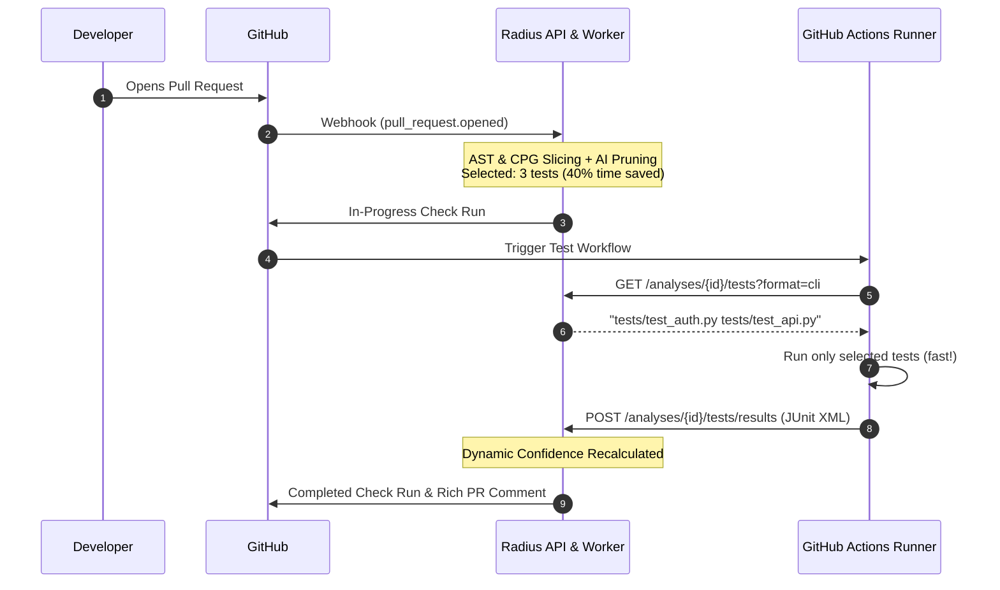

# CI/CD Integration Guide: Predictive Test Selection & Ingestion

Radius enables engineering teams to cut CI test times by up to **80%** by predicting which tests are impacted by code changes and dynamically recalculating merge confidence scores.

This guide demonstrates how to integrate Radius into your existing CI pipelines (e.g., GitHub Actions, GitLab CI, CircleCI).

---

## 1. How the Flow Works



---

## 2. GitHub Actions Workflow Example

Create `.github/workflows/radius-verify.yml` in your target repository:

```yaml
name: Predictive Verification with Radius

on:
  pull_request:
    types: [opened, synchronize, reopened]

jobs:
  verify:
    runs-on: ubuntu-latest
    steps:
      - name: Checkout code
        uses: actions/checkout@v4

      - name: Set up Python
        uses: actions/setup-python@v5
        with:
          python-version: "3.12"

      - name: Install Dependencies
        run: pip install -r requirements.txt pytest

      # 1. Fetch the Radius Analysis ID associated with this Pull Request
      - name: Fetch Radius Analysis ID
        id: radius_analysis
        run: |
          ANALYSIS_ID=$(curl -s -H "X-Radius-Organization-Id: ${{ secrets.RADIUS_ORG_ID }}" \
            -H "Authorization: Bearer ${{ secrets.RADIUS_API_KEY }}" \
            "${{ secrets.RADIUS_API_BASE_URL }}/api/v1/analyses?pullRequestId=${{ github.event.pull_request.node_id }}" \
            | jq -r '.data[0].id')
          echo "analysis_id=$ANALYSIS_ID" >> $GITHUB_OUTPUT

      # 2. Query Radius for the precision-selected tests CLI arguments
      - name: Get Predictive Tests from Radius
        id: test_selection
        run: |
          CLI_ARGS=$(curl -s -H "X-Radius-Organization-Id: ${{ secrets.RADIUS_ORG_ID }}" \
            -H "Authorization: Bearer ${{ secrets.RADIUS_API_KEY }}" \
            "${{ secrets.RADIUS_API_BASE_URL }}/api/v1/analyses/${{ steps.radius_analysis.outputs.analysis_id }}/tests?format=cli")
          echo "cli_args=$CLI_ARGS" >> $GITHUB_OUTPUT
          echo "Running impacted tests: $CLI_ARGS"

      # 3. Execute only the impacted tests and generate standard JUnit XML report
      - name: Run Impacted Tests
        run: |
          pytest ${{ steps.test_selection.outputs.cli_args }} --junitxml=junit-results.xml

      # 4. Upload JUnit XML test results to Radius to update dynamic confidence score
      - name: Upload Test Results to Radius
        if: always()
        run: |
          curl -X POST \
            -H "Content-Type: application/xml" \
            -H "X-Radius-Organization-Id: ${{ secrets.RADIUS_ORG_ID }}" \
            -H "X-Radius-API-Key: ${{ secrets.RADIUS_API_KEY }}" \
            --data-binary @junit-results.xml \
            "${{ secrets.RADIUS_API_BASE_URL }}/api/v1/analyses/${{ steps.radius_analysis.outputs.analysis_id }}/tests/results?commit_sha=${{ github.event.pull_request.head.sha }}"
```

**How uploaded results count as evidence**

- `commit_sha` is optional but recommended: if it does not match the analysed head commit the upload is rejected with `409`, so results from another commit can never verify a PR.
- Results only count for selected test files that the report shows were executed. Radius matches each `<testcase>` by its `file` attribute or `classname` (pytest's dotted module such as `tests.test_checkout`, or the file path used by Vitest/jest-junit). Skipped cases do not count.
- Any selected test file missing from the report keeps the verdict at `insufficient_evidence`. Aggregate-only reports (totals without per-test entries) cannot be attributed and never verify a PR.

---

## 3. Supported Test Frameworks

The JUnit XML report format (`--junitxml` in pytest, `vitest run --reporter=junit`, `jest --reporters=jest-junit`) is universal:

| Language | Test Framework | Command Generating JUnit XML |
| :--- | :--- | :--- |
| **Python** | `pytest` | `pytest <tests> --junitxml=report.xml` |
| **TypeScript / JS** | `vitest` | `vitest run <tests> --reporter=junit --outputFile=report.xml` |
| **TypeScript / JS** | `jest` | `jest <tests> --reporters=default --reporters=jest-junit` |
| **Go** | `go test` | `go test <packages> -v 2>&1 \| go-junit-report > report.xml` |
| **Java / Kotlin** | `Maven / Gradle` | Native XML reports generated in `build/test-results/` or `target/surefire-reports/` |

---

## 4. Immediate Benefits

1. **Massive CI Cost & Time Savings**: Only tests reachable from modified diff hunks and callers are executed.
2. **Instant Developer Feedback**: In-progress check runs and PR comments keep engineers informed without leaving GitHub.
3. **Evidence-Backed Merge Confidence**: If any test fails, Radius automatically adjusts the Confidence Score and elevates the Risk Level before code hits production.
