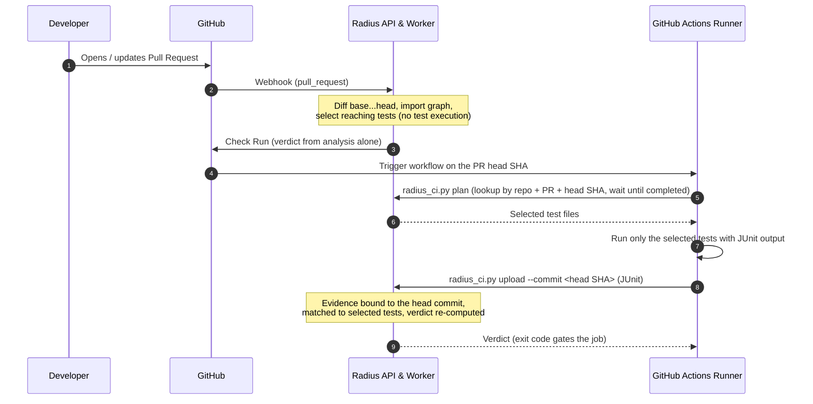

# CI/CD Integration Guide: Graph-Driven Test Selection & Evidence Upload

Radius selects the tests that the import graph connects to a pull request's changes (plus naming-convention matches and a full-suite fallback when it cannot map a change), lets your CI run them, and turns the uploaded results into an evidence-gated verdict: `verified`, `failed` or `insufficient_evidence`. No general CI time-saving figure is claimed; measured selection and timing numbers on a small self-evaluation corpus are in [benchmarks/REAL_REPO_BENCHMARK.md](benchmarks/REAL_REPO_BENCHMARK.md).

Tests from the pull request run in **your** CI, never inside the Radius worker by default (see [security/EXECUTION_ISOLATION.md](security/EXECUTION_ISOLATION.md)).

---

## 1. How the Flow Works



The Radius Check Run is published when the analysis completes. It is **not yet re-published after CI uploads**, so for uploaded evidence the merge gate is the exit code of the CI job below (make that job a required status check).

---

## 2. GitHub Actions Workflow

Copy [examples/radius-ci-workflow.yml](examples/radius-ci-workflow.yml) to `.github/workflows/radius.yml` in your repository. It uses the composite action `.github/actions/radius-verify` (a thin wrapper around `scripts/radius_ci.py`, so there is one integration) with:

| `command` | What it does |
| --- | --- |
| `plan` | Looks up the analysis for `repository` + `pull-request` + `commit-sha` (`GET /api/v1/analyses/lookup`), waits until it is `completed`, writes the selected test files to `tests-file`. Outputs `analysis-id`, `tests-file`, `test-count`, `has-tests`. |
| `upload` | Uploads one or more JUnit files bound to the head commit, prints the per-upload summary, the verdict and its gaps. Output `verification-status`. |
| `verdict` | Reads the current verdict without uploading (used when no tests were selected). |
| `resolve` | Only resolves and prints the analysis id. |

Set `require-verified: "true"` on `upload`/`verdict` for a required status check.

**Exit codes of `scripts/radius_ci.py`:** `0` ok · `1` error (HTTP/network, with an actionable message for 401/403/404/409/422/5xx) · `2` usage · `3` timed out waiting for the analysis · `4` verdict `failed` · `5` verdict not `verified` with `--require-verified`.

**Notes**

- Check out the PR **head** SHA (`github.event.pull_request.head.sha`); `pull_request` runs default to a merge commit, which is not the analysed revision.
- The API key is read from `RADIUS_API_KEY` (env), sent as `X-Radius-API-Key`, and scrubbed from all output. Never use `pull_request_target` to get secrets on fork PRs: it runs untrusted code with your secrets.
- Test paths come from the PR; the example reads them into a bash array from a file instead of interpolating them into the script.

**How uploaded results count as evidence**

- `commit_sha` is required (`422` if missing). If it does not match the analysed head commit the upload is rejected with `409`, so results from another commit can never verify a PR.
- Results only count for selected test files that the report shows were executed. Radius matches each `<testcase>` by its `file` attribute or `classname` (pytest's dotted module such as `tests.test_checkout`, or the file path used by Vitest/jest-junit). Skipped cases do not count.
- Any selected test file missing from the report keeps the verdict at `insufficient_evidence`. Aggregate-only reports (totals without per-test entries) cannot be attributed and never verify a PR.

---

## 3. Supported Test Frameworks

The JUnit XML report format (`--junitxml` in pytest, `vitest run --reporter=junit`, `jest --reporters=jest-junit`) is universal:

| Language | Test Framework | Command Generating JUnit XML |
| :--- | :--- | :--- |
| **Python** | `pytest` | `pytest <tests> --junitxml=report.xml` |
| **TypeScript / JS** | `vitest` | `vitest run <tests> --reporter=junit --outputFile=report.xml` |
| **TypeScript / JS** | `jest` | `jest <tests> --reporters=default --reporters=jest-junit` |
| **Go** | `go test` | `go test <packages> -v 2>&1 \| go-junit-report > report.xml` |
| **Java / Kotlin** | `Maven / Gradle` | Native XML reports generated in `build/test-results/` or `target/surefire-reports/` |

---

## 4. Immediate Benefits

1. **Massive CI Cost & Time Savings**: Only tests reachable from modified diff hunks and callers are executed.
2. **Instant Developer Feedback**: In-progress check runs and PR comments keep engineers informed without leaving GitHub.
3. **Evidence-Backed Merge Confidence**: If any test fails, Radius automatically adjusts the Confidence Score and elevates the Risk Level before code hits production.

---

## Running Radius-selected tests in your CI (recommended execution model)

Radius does not execute pull-request code inside its own worker by default (`WORKER_EXECUTE_TESTS=false`). Instead, your CI runs the tests Radius selected and uploads the results. `scripts/radius_ci.py` (standard library only) and the composite action `.github/actions/radius-verify` implement this flow:

```bash
export RADIUS_API_KEY=...   # from a CI secret; never passed on the command line
# 1. Ask Radius which test files to run (one path per line; empty = nothing selected)
python scripts/radius_ci.py plan --api "$RADIUS_API_URL" --org "$RADIUS_ORG_ID" --analysis "$ANALYSIS_ID" > radius-tests.txt
# 2. Run them with JUnit output
[ -s radius-tests.txt ] && python -m pytest $(cat radius-tests.txt) --junitxml=junit.xml
# 3. Upload, bound to the commit that was tested
python scripts/radius_ci.py upload --api "$RADIUS_API_URL" --org "$RADIUS_ORG_ID" \
  --analysis "$ANALYSIS_ID" --junit junit.xml --commit "$GITHUB_SHA"
```

Or, in GitHub Actions, after the test step:

```yaml
- uses: Mohith-c7/Radius/.github/actions/radius-verify@develop
  if: always()
  with:
    api-url: ${{ secrets.RADIUS_API_BASE_URL }}
    organization-id: ${{ secrets.RADIUS_ORG_ID }}
    analysis-id: ${{ steps.radius_analysis.outputs.analysis_id }}
    api-key: ${{ secrets.RADIUS_API_KEY }}
    junit-path: junit.xml
```

The helper validates the analysis id (UUID) and commit SHA (hex), uses 30-second timeouts, refuses HTTP redirects so the API key is never forwarded to another host, and exits non-zero with the server's error message when the upload is rejected (for example `409` when the commit does not match the analysed head). If the selection is empty there is nothing to run or upload (skip step 3); the verdict then stays `insufficient_evidence` unless the change is docs-only.

## Evidence binding and upload semantics

`POST /api/v1/analyses/{analysis_id}/tests/results?commit_sha=<head sha>` accepts one JUnit XML or JSON report per request. An upload only becomes evidence when it is bound to the analysed revision, and a rejected upload never changes the verdict.

**Checks, in order:**

| Condition | Response |
| --- | --- |
| Caller's organization does not own the repository | `403` |
| `commit_sha` missing or empty | `422`. Pass the head commit the tests ran on, e.g. `?commit_sha=$GITHUB_SHA`. |
| Analysis status is `failed` or `cancelled` | `409`. Re-run the analysis and upload to the new analysis id. |
| `commit_sha` differs from the analysed head commit | `409` |
| A newer analysis of the same pull request has a different head commit (the analysis is stale) | `409`. The message names the latest analysis id. |
| Body is empty, not well-formed XML/JSON, not a JUnit `<testsuite>`/`<testsuites>` report, uses forbidden XML constructs (DTD entities), or has negative counts | `422`. Nothing is stored. |

**Multiple uploads accumulate.** Each distinct report is stored (with its commit, SHA-256 of the body, counts and per-test-case identities) instead of replacing the previous one, so CI shards can upload separately:

- *Failures are sticky.* If any upload reports a failure, the aggregate stays `failed`, even if a later upload (another shard or a retry) passes.
- *Contradictions count as failures.* A test case reported as passed in one place and failed in another is listed in `contradictory_cases` and counted as failed, never passed.
- *Executed cases are unioned.* A selected test file counts as executed if any upload shows one of its cases passing or failing.
- *Replays are idempotent.* Re-sending an identical body returns `upload.duplicate: true` and is not counted twice.
- *Counts are summed* over distinct uploads. Coverage is the lowest coverage any upload reported.

**What counts as evidence.** A selected test file is only evidence if the results show it ran. Being in the plan is not enough. The response's `selected_tests` object splits the selection into `executed` (= `passed` + `failed`), `failed`, `skipped` (only skipped cases reported) and `not_reported`, with counts for each. Skipped and not-reported files keep the verdict at `insufficient_evidence`. So do aggregate-only reports with no `<testcase>` / `testcases` entries, and an analysis with no selected test files while executable changes exist.

**Response shape** (inside the usual `{"success": true, "data": ...}` envelope):

```json
{
  "status": "failed", "total_tests": 3, "passed": 2, "failed": 1, "skipped": 0,
  "upload_count": 2,
  "upload": {"id": "…", "commit_sha": "…", "body_sha256": "…", "duplicate": false,
             "status": "passed", "total_tests": 2, "passed": 2, "failed": 0, "skipped": 0,
             "reported_cases": 2},
  "selected_tests": {"selected_count": 2, "executed_count": 2, "passed_count": 1,
                     "failed_count": 1, "skipped_count": 0, "not_reported_count": 0,
                     "executed": ["…"], "failed": ["…"], "skipped": [], "not_reported": []},
  "contradictory_cases": [],
  "verification_status": "failed"
}
```

Top-level counts are the aggregate over every upload that the verdict is computed from. `upload` describes only this request. `GET …/tests/results` returns the same aggregate counts.

## Making the Verdict v2 check required (advisory first, then blocking)

Applies when `RADIUS_FEATURE_VERDICT_V2=on`. The Check Run is named `Radius confidence`.

1. **Start advisory.** Add `.radius/policy.yml` to the default branch with `mode: advisory` (see `docs/policy.md` and `.radius/policy.example.yml`). The check never reports `failure`; read the comments for a few weeks and tune thresholds, waivers and exclusions through reviewed changes to `.radius/`.
2. **Upload per-case CI results.** Until results arrive the verdict is "awaiting CI" and the comment updates itself.
3. **Switch to `mode: blocking`** in a reviewed PR. Every unverified result (failed, insufficient evidence, needs review, still pending) then reports `failure`. GitHub counts `neutral` as passing for a required check, which is why advisory and blocking differ only in this mapping; the verdict itself is identical.
4. **Mark `Radius confidence` as a required status check** in branch protection (`docs/github-branch-protection.md`) and protect `.radius/` with CODEOWNERS, because the policy and waivers are read from the base branch and are the control surface.

Not yet validated on a live sandbox repository (VD-09 stays open for that).
