# Radius — Engineering Audit, Research Validation, and Remediation Plan

| | |
| --- | --- |
| Audit date | 2026-11-01 |
| Audited revision | `develop` @ `2272df2` (default branch on GitHub is `dev`, 38 commits behind `develop`) |
| Method | Full source read of the Python pipeline, empirical scenario probes against the real orchestrator, local reproduction of every CI step, GitHub Actions log review, primary-source competitive research |
| Scope limits | No live GitHub App installation, no PostgreSQL run, dashboard not exercised in a browser (see §G.4) |

---

## A. Executive audit

**Verdict: prototype with substantial gaps.** Radius has a credible *skeleton* — clean domain packages, a durable SQL job queue, signed webhooks, idempotent webhook handling, JUnit ingestion, and a GitHub Check/PR-comment publisher. It did **not** yet answer its own core question ("can this PR be merged safely?") truthfully. Before this branch, the system could, and in our probes did, tell a reviewer that a broken PR was low-risk.

The user's concern ("too basic, insufficiently differentiated, or misaligned") is **partly right, for a different reason than expected**. The architecture is not too simple. The problem is that the pieces that look sophisticated (the AI semantic pruner, the CPG, "predictive" selection, the 0–100 score) were not connected to measured evidence. The parts that matter most (selection reaching the right tests, honest execution results, a verdict that abstains without evidence) were the weakest.

### Real strengths (verified by reading code and running tests)

| Strength | Evidence |
| --- | --- |
| Clear package boundaries (`repository`, `parser`, `graph`, `analysis`, `testing`, `confidence`, `github`, `shared`) with domain / application / infrastructure / interfaces layering | `packages/*/src/radius_*/{domain,application,infrastructure,interfaces}` |
| Durable SQL job queue with claim / stale-requeue / max-attempts | `packages/analysis/src/radius_analysis/infrastructure/sqlalchemy_job_queue.py`, `apps/worker/src/radius_worker/runner.py` |
| HMAC-SHA256 webhook verification with constant-time compare | `apps/api/src/radius_api/routes/github_webhooks.py` (`_validate_signature`) |
| Delivery-ID idempotency with body-hash conflict detection | `apps/api/src/radius_api/idempotency.py` |
| JUnit XML ingestion hardened with `defusedxml` | `packages/testing/src/radius_testing/infrastructure/junit_parser.py` |
| Test-environment secret stripping for subprocesses | `packages/testing/src/radius_testing/infrastructure/subprocess_runner.py` (`SAFE_ENV_VARS`) |
| 225 passing unit/integration tests (2 skipped OSS-target tests) | local run, §G |

### Critical weaknesses (all demonstrated, not inferred)

| # | Finding | Evidence | Severity |
| --- | --- | --- | --- |
| 1 | **False safety.** PR that breaks `checkout` got **90/100, LOW risk → Check `success`**, while the full suite had 1 failure (probe S11). Score had no notion of "changed code not covered by any executed test". | `packages/confidence/src/radius_confidence/infrastructure/scoring.py` (pre-fix), `packages/github/src/radius_github/publisher.py:171` (`_check_conclusion` keyed on risk only) | P0 |
| 2 | **Test selection ignored the dependency graph.** Graph-reachable test files were never selected; selection was filename convention only. A real regression selected **0 tests** and reported **"100% time saved"** (S1). | `packages/testing/src/radius_testing/infrastructure/selection.py` (pre-fix) | P0 |
| 3 | **AI could delete tests from the blast radius.** An LLM "benign" verdict removed a caller's *whole file* from affected paths, and in the SQL worker path the "diff" sent to the model was the literal string `"None"`. | `apps/worker/src/radius_worker/orchestrator.py:96-120, 318-319` (pre-fix); worker command never sets `diff_text` (`runner.py:305`) | P0 |
| 4 | **Untrusted PR code executed inside the privileged worker** (same uid as the process holding `DATABASE_URL` and the GitHub App private key; env stripping does not stop `/proc/<ppid>/environ` reads or network egress). | `apps/worker/src/radius_worker/runner.py:250,329`, `subprocess_runner.py` | P0 (security) |
| 5 | **Backdoor admin account.** Every API startup — production included — created/reset `demo@radius.dev` / `RadiusDemo123!` (admin role, password re-synced each boot). | `apps/api/src/radius_api/seed.py:84-97`, `apps/api/src/radius_api/main.py:69-71` | P0 (security) |
| 6 | **Fabricated evidence presented as authentic.** Startup seeds hard-coded reports ("92.0 … Safe to merge", "96.3% CI time saved") labelled "authentic open source … results"; no measurement produced them. | `apps/api/src/radius_api/seed.py:244-289` | P0 (integrity) |
| 7 | **Runner dishonesty / crashes.** Missing `jest`/`vitest` binary → `FileNotFoundError` crashed the whole analysis (S2, S8). Counts were *files*, not tests; any non-zero exit marked *every* file failed; pytest "no tests collected" became a failure (S10); timeouts became failures. | `subprocess_runner.py:60,76` (pre-fix), `planner.py` | P0 |
| 8 | **One malformed `.py` file aborted the analysis** (S4: `SyntaxError`). | `packages/parser/src/radius_parser/application/services.py` (pre-fix) | P0 |
| 9 | **Dependency resolution gaps**: `../` relative imports never matched (no path normalisation); `from pkg import mod` resolved only to `pkg/__init__.py`; src-layout imports unresolved; only top-level Python imports read; JS/TS imports parsed line-by-line by regex, so multi-line `import {…} from` (Prettier default) was invisible. | `packages/graph/src/radius_graph/infrastructure/module_resolver.py`, `packages/parser/src/radius_parser/infrastructure/{python_parser,ecmascript_parser}.py:57` | P0/P1 |
| 10 | **Deleted/renamed files had zero impact** (S5) — dependents are computed from the head snapshot where the file no longer exists. Config/manifest changes also had zero impact (S6). | `analysis/application/services.py` (`compute_blast_radius`) | P0 |
| 11 | **CI red on every recent run** (≥10 consecutive): unpinned `ruff` introduced UP046/UP047; root `tests/` (the e2e suites) is not a pnpm workspace so CI never runs it. | GitHub Actions runs 55–64; `packages/shared/src/radius_shared/dto/responses.py` | P0 (process) |
| 12 | **Cross-repository test collisions**: `test_cases.path` is globally `UNIQUE`; selection read *all* persisted tests, not this snapshot's. | `packages/shared/src/radius_shared/database/models.py:403-417`, `testing/infrastructure/sqlalchemy_store.py` | P1 (tenant isolation) |
| 13 | **Insecure defaults**: `RADIUS_ENV` defaults to `development`, which disables webhook signature enforcement when no secret is set and disables API-key checks when `API_KEYS` is empty (any `X-Radius-Organization-Id` header is trusted). | `packages/shared/src/radius_shared/config.py:32`, `routes/github_webhooks.py:310`, `apps/api/src/radius_api/auth.py:61` | P1 (security) |
| 14 | **Multi-tenancy is nominal**: unknown installations fall back to `GITHUB_DEFAULT_ORGANIZATION_ID`, and `_record_installation_id` can overwrite that org's installation id with whichever installation delivered last. | `routes/github_webhooks.py:354,395` | P1 (security) |
| 15 | Ingestion re-scoring used a fabricated `ImpactEvidence(1,1,1,…)` and mutated a private store field (`_reports.pop`). In-memory store silently dropped `verification_status`. | `confidence/application/services.py:77,111` (pre-fix), `confidence/infrastructure/in_memory.py` | P1 |

### Is the architecture on the right path?

Yes, with redirection. The package layout and the file-level dependency graph plus test mapping are the right base. Those are table stakes in this space. Bazel, Pants, Ekstazi and STARTS all select tests by dependency reachability (§D). The wrong turn was investing in LLM pruning and presentation before the deterministic core was correct. The recommended thesis (§D.3) is: **evidence-gated merge verdicts**. Radius says "verified" only when every executable change is mapped to tests that actually ran and passed, and otherwise abstains and says why.

---

## B. Architecture and feature audit

### B.1 Repository map

```text
apps/
  api/        FastAPI. Two apps in one process: radius_api (domain REST, webhooks) + app (session auth, OAuth, password reset)
  worker/     SQL-polling worker: clone → diff → parse → graph → select → (run) → score → publish
  dashboard/  Next.js 15 console (data-panels.tsx 2.6k LOC, interactive SVG graph)
packages/
  repository/ Repo/branch/PR entities + local git client (clone/fetch/checkout)
  parser/     PythonAstParser (stdlib ast), JS/TS regex parser, tree-sitter Go/Java/Rust; separate tree-sitter "extractors" used only by the POC CPG
  graph/      File/symbol/import/module graph + ModuleResolver; POC CodePropertyGraph + GraphSlicer
  analysis/   Diff parsing, change analysis, blast radius, AI SemanticPruner (Gemini)
  testing/    Discovery, selection, planning, subprocess runner, JUnit/JSON ingestion
  confidence/ Scoring + reports
  github/     GitHub App client (JWT, installation tokens), Check Runs, PR comments
  shared/     SQLAlchemy models, settings, errors, logging
infra/database/migrations  Alembic 0001–0004
tests/        Root e2e suites (webhook→comment, synthetic target, OSS targets) — not run by CI before this branch
benchmarks/   Unit tests named "benchmarks"; no measurements
tmp/, output/, .docker-*-smoke/, *.docx, audit_script.py, generate_capstone_diary.py  — non-product artifacts committed at the root
```

### B.2 End-to-end data-flow trace (what really happens)

| Hop | Intended | Actual (pre-fix) | Persisted? | Error propagation |
| --- | --- | --- | --- | --- |
| 1. GitHub PR event | Signed webhook starts analysis | `pull_request` opened/reopened/synchronize/ready_for_review → upsert repo/PR → `start_analysis` → job row. No dedup by (PR, head SHA). | Yes (`analyses`, `analysis_jobs`, idempotency) | Signature failures → 403; missing secret in non-prod → **accepted unsigned** |
| 2. Clone & checkout | Fetch PR head | `clone_or_fetch` with installation token header, `fetch_pull_request` (errors swallowed at debug level), checkout head SHA | Repo cache dir | Exceptions → job requeue/fail |
| 3. Changed-file detection | Diff base…head | `git diff --find-renames --find-copies origin/<target>...<sha>` → unified-diff parser | `changed_files` | Good |
| 4a. Phase-2 POC CPG | Symbol-level impact | **Parallel pipeline**: re-walks and re-parses the whole repo with tree-sitter extractors, builds a CPG, slices callers, and — only if `GEMINI_API_KEY` is set — asks Gemini per caller whether it is impacted; "benign" removes the caller's *entire file* from affected paths. In the SQL path `diff_text` is `None`, so the model received the string `"None"` as the diff. All exceptions swallowed (`except Exception: pass`). Output used **only** to subtract files. | No | Swallowed |
| 4b. Phase-1 parse | Parse sources | Re-parses the whole repo again (no incrementality) via `ParserApplicationService`; first `SyntaxError`/`UnicodeDecodeError` aborts the analysis | No | Crash |
| 5. Graph | Dependency model | File/symbol/import/export/module nodes; file→file `DEPENDS_ON` only when `ModuleResolver` resolves (gaps listed in A#9) | `graph_snapshots` (JSON) | — |
| 6. Impact | Changed symbols + blast radius | File-level reverse closure; counts of files/symbols/modules/depth. Symbol-level hunk data is computed only inside the POC and never reaches selection. Deleted files contribute nothing. | `blast_radius` | — |
| 7. Test selection | Dependency-aware | Naming convention + `target_path` heuristic; **graph-reached test files ignored**; tests read from the global table | `test_selections` | — |
| 8. Execution | Run selected tests | `python -m pytest <files>` / bare `jest` / bare `vitest` in the worker process; exit-code only; file counts | `test_runs` | Missing binary → crash |
| 9. Confidence | Explainable evidence → score | 100 minus fixed penalties; no notion of unmapped change; ≥85 → LOW | `confidence_reports` + evidence | — |
| 10. Report | Check + comment | Conclusion from risk only; "time saved" = pytest-*skipped* / total (unrelated to selection); on analysis failure nothing is published, so a previously created `in_progress` check can remain stuck | GitHub | Publish errors logged, swallowed |

**Two code-intelligence pipelines.** Phase 1 (`radius_parser.infrastructure` → `GraphApplicationService`) drives the persisted graph, the blast radius and test selection. The Phase-2 POC (`radius_parser.extractors` + `radius_graph.cpg`/`slicer`) builds a richer symbol/call graph, but its only effect on the result was AI-driven *removal*. The two duplicate parsing (two full repo walks per analysis) and disagree on language support. The symbol-level work never improved selection precision.

### B.3 Feature implementation matrix

Classification key: **IV** implemented & verified · **IU** implemented, insufficiently verified · **P** partial · **M** mocked/simulated · **X** missing · **FD** fundamentally misdesigned.

| Feature | Intended | Actual | Evidence | Verification performed | Gaps / failure modes | Sev | Action | Class (pre-fix) |
| --- | --- | --- | --- | --- | --- | --- | --- | --- |
| GitHub App auth | JWT → installation token | Implemented | `packages/github/src/radius_github/client.py` | Unit tests (mocked HTTP) | No live installation tested | P2 | Keep; add live smoke test | IU |
| Webhook verification | HMAC, reject unsigned | Implemented; unsigned accepted when secret empty and env≠production (default env = development) | `routes/github_webhooks.py:310` | Read + tests | Insecure default | P1 | Fail closed unless explicitly dev | IU |
| Webhook idempotency / retries | Same delivery → same response | Delivery-ID + body hash; save after processing (race on concurrent duplicates); no (PR, SHA) dedup | `apps/api/src/radius_api/idempotency.py` | Existing tests | Duplicate analyses per SHA | P2 | Unique (pr, sha) analysis key | IU |
| Tenant isolation | Org-scoped data | API key per org (only if configured); webhooks map unknown installs to default org | `auth.py:61`, `github_webhooks.py:354,395` | Read | Shared default org; install-id overwrite | P1 | Installation→org table, fail closed | P |
| Repo sync / clone | Fetch PR head | Implemented | `repository/infrastructure/local_git.py`, `runner.py` | Existing tests (local git) | No size/time limits on clone | P2 | Limits, shallow fetch | IU |
| Diff / changed files | Exact changed files | Implemented incl. renames/deletes | `unified_diff_change_analyzer.py` | Tests + probes | — | — | Keep | IV |
| Parsing — Python | AST symbols/imports | stdlib `ast`; top-level imports only; crash on bad file | `python_parser.py` | Probes S1, S4 | Nested imports, `from pkg import mod` | P0 | **Fixed in this branch** | P |
| Parsing — JS/TS | Tree-sitter | Line-based regex | `ecmascript_parser.py:57` | Read | Multi-line imports, re-exports, aliases | P1 | Whole-file regex now; tree-sitter next | P |
| Parsing — Go/Java/Rust | Symbols/imports | Tree-sitter parsers exist; package imports not resolved to files | `tree_sitter_parsers.py` | Existing tests | Imports never resolve → changes unmapped | P2 | Language resolvers | P |
| Symbol extraction | Defs + refs | Defs yes; refs/calls only in POC CPG | `extractors/*`, `graph/cpg.py` | Existing tests | Not used by selection | P2 | Merge pipelines | P |
| Import resolution | Cross-file edges | `ModuleResolver`: no `..` normalisation, no src-layout, no submodule-from-package, no tsconfig paths / package exports | `module_resolver.py` | Probes S1, S2 | False negatives | P0 | **Fixed (`..`, src, submodules)**; aliases P1 | FD→P |
| Graph construction | Dependency graph | File/symbol/import/module nodes, full rebuild per analysis | `graph/application/services.py` | Tests | No incrementality; JSON snapshot per analysis | P3 | Content-hash cache | IU |
| Graph freshness | Incremental | Missing | — | — | Full re-parse ×2 per run | P3 | Cache by blob SHA | X |
| Changed-symbol detection | Hunk → symbol | Only inside POC; never reaches selection | `analysis/diff_hunks.py`, orchestrator POC | Existing tests | Unused | P2 | Feed symbol impact into mapping | P |
| Blast radius | Transitive impact | File reverse closure; deleted files → 0 | `analysis/application/services.py` | Probe S5 | Deletions/renames/config invisible | P0 | **Fixed via full-suite fallback** | P |
| AI semantic pruning | Reduce noise safely | LLM can drop files → tests; `"None"` diff in SQL path; sends source to third party when key set | `orchestrator.py:96-120,318`, `analysis/ai/pruner.py` | Read | False-safety, privacy, irreproducible | P0 | **Removed from critical path** | FD |
| Test discovery | Find tests | Filename/dir heuristics; `conftest.py`, fixtures, helpers counted as tests | `testing/infrastructure/discovery.py` | Probe S9 | Inflated counts, wrong commands | P1 | **Fixed (exclusions)** | P |
| Test selection | Dependency-aware RTS | Convention-only; graph ignored; global test table | `selection.py`, `application/services.py` | Probes S1, S3, S11 | Missed regressions | P0 | **Fixed (graph + fallback + per-snapshot)** | FD |
| Full-suite fallback | Safe default | Missing | — | Probes S5, S6 | Silent zero selection | P0 | **Fixed** | X |
| Test execution | Isolated, reliable | In-worker subprocess, not sandboxed; crash on missing binary; file-level counts | `subprocess_runner.py`, `planner.py` | Probes S2, S8, S10 | Security + dishonest results | P0 | **Honest runner; execution opt-in**; sandbox P0 follow-up | FD |
| CI result ingestion | JUnit/JSON → evidence | Parses counts; not matched to selected tests; fake impact on re-score | `junit_parser.py`, `routes/tests.py`, confidence service | Existing tests | Any JUnit file can "verify" | P1 | **Re-score reuses recorded mapping**; matching P1 | P |
| Confidence engine | Explainable, evidence-based | Fixed penalties from 100; can be 90 with untested changes | `confidence/infrastructure/scoring.py` | Probe S11 | Uncalibrated, no abstention | P0 | **Evidence-gated verdict + caps** | FD |
| Coverage evidence | Measured | Field exists; never produced by runner | `TestRunResult.coverage_percent` | Read | Always "missing" | P2 | Collect coverage in CI path | M |
| GitHub Check / comment | Truthful summary | Conclusion from risk only; "time saved" from pytest skips; stuck `in_progress` on failure | `publisher.py:171,198`, `runner.py:482` | Unit tests | Misleading | P0 | **Verdict-based conclusion + `publish_failure`** | P |
| Dashboard | Evidence UI | Real API client; startup seeds fabricated "authentic" results | `apps/dashboard/lib/api.ts`, `seed.py` | Read only (no browser) | Fake data indistinguishable from real | P0 | **Seeding opt-in + labelled**; UI review P1 | M |
| Auth (users) | Sessions, OAuth | Implemented (argon2, tokens, OAuth); seeded backdoor admin | `apps/api/src/app/*`, `seed.py:84-97` | Existing tests | Hard-coded credential | P0 | **Fixed (opt-in, no reset)** | IU |
| DB schema / migrations | Consistent | Alembic 0001–0004; `test_cases.path` global unique | `models.py:403` | `alembic upgrade` in CI (not run locally) | Cross-repo collision | P1 | Repo-scoped migration | P |
| Jobs / retries | Durable | SQL queue with stale requeue | `sqlalchemy_job_queue.py` | Existing tests | No dead-letter visibility in UI | P2 | Keep | IV |
| Observability | Logs/metrics | Mix of `print` and logger; no metrics/tracing | orchestrator, seed | Read | Hard to operate | P2 | Structured logs, metrics | P |
| CI/CD | Green, representative | Red on every recent run; root e2e never run | Actions runs 55–64 | Reproduced locally | Merges unvalidated | P0 | **Fixed (pin ruff, add root tests)** | P |
| Benchmarks | Measured value | Unit tests in `benchmarks/`; README "up to 80%" unsupported | `benchmarks/test_benchmarks.py`, `README.md` | Read | Unsupported claim | P1 | Benchmark harness (§G.3) | M |

---

## C. Maturity scorecard

| Dimension | Score (pre-fix → after this branch) | Rationale | Confidence |
| --- | --- | --- | --- |
| Engineering maturity | **38 → 52** | Good modularity, queue, idempotency, typed DTOs, 225 tests. Pre-fix: crashes on common inputs, dishonest runner, false-safety verdicts, untrusted code in privileged process, red CI. This branch fixes correctness/honesty of the core path; sandboxing, tenancy, incremental graph remain. | High (code read + probes) |
| Product maturity | **30 → 40** | End-to-end flow exists (webhook → check run), but outputs were not trustworthy and the demo data was fabricated. Now outputs are honest but frequently "insufficient evidence" until CI ingestion / sandboxed execution is wired into the default flow. No live GitHub App validation. | Medium (no browser/live App run) |
| Research maturity | **10 → 18** | No stated hypothesis, baselines, datasets or metrics; README performance claim unmeasured; AI pruning never evaluated. This branch adds a falsifiable claim (verdict safety) and a probe set, not yet a benchmark. | High |
| Commercial readiness | **15 → 20** | Docker compose and docs exist; insecure defaults, single-tenant installation mapping, no sandbox, no ops visibility, no pricing/onboarding validation. | Medium |

---

## D. Competitive and research assessment

### D.1 Sources (primary where available)

| Topic | Verified facts (from primary/academic sources) | Marketing claims (unverified) |
| --- | --- | --- |
| Ekstazi (Gligoric, Eloussi, Marinov, ISSTA 2015) | Dynamic file-dependency RTS for Java/JUnit; 615 revisions of 32 projects (~5M LOC); end-to-end time −32% avg, −54% for longer suites; ACM SIGSOFT Distinguished Paper. [paper](https://users.ece.utexas.edu/~gligoric/papers/abstracts/GligoricETAL15Ekstazi.txt), [thesis](https://users.ece.utexas.edu/~gligoric/papers/Gligoric15PhD.pdf) | — |
| STARTS (Legunsen, Shi, Marinov; ASE 2017 demo; FSE 2016 study) | Static class-level RTS for Maven: builds class dependency graph, selects test classes that reach a changed class; comparable to Ekstazi at class level; reflection rarely made it unsafe in practice. [NSF PAR](https://par.nsf.gov/search/author:%22Owolabi%20Legunsen%22), [slides](https://api.sambuz.com/doc/an-extensive-study-of-static-regression-test-selection-in-presentation-788921) | — |
| Predictive Test Selection (Machalica et al., Facebook, ICSE-SEIP 2019) | ML model trained on historical outcomes; ~halves test infra cost while reporting >95% of individual failures and >99.9% of faulty changes; handles flakiness. [arXiv 1810.05286](https://arxiv.org/abs/1810.05286), [ICSE page](https://2019.icse-conferences.org/details/icse-2019-Software-Engineering-in-Practice/22/Predictive-Test-Selection) | — |
| Google TAP (Memon et al., ICSE-SEIP 2017) | Google cannot regression-test every change individually; few tests ever fail; failing tests are "closer" to the code they test; churn and >3 recent authors correlate with breakage. [Google Research](https://research.google/pubs/taming-google-scale-continuous-testing/) | — |
| Bazel | `rdeps(//..., set(<changed files>))` filtered by `kind(test, …)` is a standard CI pattern (used in Bazel's own `ci.sh`); caveats: deleted files can't be queried, `.bzl` load graph not covered, `query` vs `cquery`. [Bazel ci.sh](https://bazel.googlesource.com/bazel/+/refs/heads/release-9.3.0/scripts/ci/ci.sh), [VirtusLab book](https://bazel.virtuslab.com/book/5~2~7/) | — |
| Pants | `--changed-since=<ref> --changed-dependents=transitive test` runs tests for changed targets and transitive dependents (dependency inference for Python etc.). [Pants docs](https://pantsbuild.org/dev/reference/subsystems/changed) | Community write-up: "70% CI test load reduction" ([blog](https://tkbadamdorj.github.io/blog/2025/pants)) — single team anecdote |
| CloudBees Smart Tests (formerly Launchable; acquired 2024) | Commercial predictive test selection + flaky-test/failure triage; integrates with CI and runners (e.g. pytest). [CloudBees](https://www.cloudbees.com/blog/how-cloudbees-smart-tests-works), [AWS Marketplace](https://aws.amazon.com/marketplace/pp/prodview-mi3tgu7krlo5a) | "40–80% faster failure detection", "up to 80% faster test execution"; CloudBees' own materials disagree on whether the method is history-trained ML or GenAI similarity with "no training period" ([press](https://www.cloudbees.com/newsroom/cloudbees-smart-tests-brings-control-to-ai-generated-code)) |
| Graphite | Stacked PRs workflow (Phabricator lineage); AI reviewer launched as Diamond (Mar 2025), name deprecated Oct 2025, now "Graphite Agent". [Graphite blog](https://graphite.com/blog/making-ai-code-review-accessible), [DevClass](https://devclass.com/2025/03/19/graphite-debuts-diamond-ai-code-reviewer-insists-ai-will-never-replace-human-code-review) | Review-quality claims |
| CodeRabbit | LLM PR review on GitHub/GitLab/Azure DevOps/Bitbucket; summaries, walkthroughs, line comments, YAML config, IDE + CLI. [docs](https://docs.coderabbit.ai/) | Competitor comparison table on coderabbit.ai/features |

### D.2 Comparison matrix

| | Radius (after this branch) | Bazel / Pants | Ekstazi / STARTS | FB PTS / Smart Tests | CodeRabbit / Graphite Agent |
| --- | --- | --- | --- | --- | --- |
| Core problem | Is this PR verified safe to merge? | Correct, cached, incremental builds/tests | Safe RTS (research) | Cheaper CI via ML-predicted failures | Review comments / workflow |
| Approach | Static import graph + conventions + conservative fallback + evidence-gated verdict | Explicit/inferred build graph, `rdeps` | Dynamic file deps / static class graph | Learned model on test history | LLM over diff/context |
| Code intelligence | File-level imports (Py, JS/TS; Go/Java/Rust parsed but unresolved) | Precise, hermetic (requires BUILD adoption) | JVM bytecode/classes | None (metadata features) | LLM context retrieval |
| Test selection | Yes (graph + convention + fallback) | Yes (sound w.r.t. declared graph) | Yes (safe w.r.t. tracked deps) | Yes (unsafe by design, probabilistic) | No |
| Execution | Opt-in in worker; recommended in customer CI + ingestion | Native | Via build tool | Customer CI | No |
| Verification evidence | Per-file mapping + executed results | Test results | Test results | Test results | None |
| Confidence/risk | Verdict + heuristic score, explicit abstention | None | None | Failure probability | Qualitative |
| Explainability | Per-file evidence items, gap reasons | Query output | Dependency files | Low | Natural language |
| Languages | Python, JS/TS (graph); others reported unanalyzed | Many (per plugin) | Java | Language-agnostic | Many |
| Deployment | GitHub App + worker | Build system adoption | Maven/Gradle plugin | SaaS / internal | SaaS |
| Known limits | Static only; no dynamic/reflection; aliases; no calibration; no sandbox | Adoption cost | JVM only | Misses some failures by design | No execution evidence |

### D.3 Product thesis and prioritisation

**Thesis.** Radius issues *evidence-gated merge verdicts*. It never claims a PR is safe unless every executable change is mapped, through an explainable dependency path, to tests that actually ran and passed. When it lacks that evidence it abstains explicitly and says what is missing. The 0–100 score is secondary and is labelled a heuristic.

This position is genuinely different. Build tools select but do not judge. Predictive selection trades safety for cost by design. AI reviewers produce opinions without execution evidence. None of them makes "what was *not* verified" the primary output. It also needs no build-system adoption, the main barrier for Bazel/Pants.

| Table stakes (must work) | Differentiators (invest) | Premature distractions (defer) |
| --- | --- | --- |
| Correct changed files, import graph, transitive dependents, full-suite fallback, honest runner/ingestion, truthful Check Run | Per-file verification map ("these 3 changed files have no test evidence"); abstention with reasons; matching ingested JUnit cases to selected tests; coverage-backed mapping; calibrated verdict accuracy on a public benchmark | LLM pruning of tests; interactive graph visualisation polish; more languages before Py/TS are precise; "AI insights" without evaluation |

---

## E. Target architecture

```mermaid
flowchart LR
  GH[GitHub App webhooks] -->|HMAC verified, idempotent| API[API: ingest events\nfail-closed auth]
  API --> Q[(SQL job queue)]
  Q --> W[Analysis worker\nno untrusted code]
  W --> C[Snapshot: clone + diff\nbase...head]
  C --> P[Parser registry\nper-file failures recorded]
  P --> G[Dependency graph\nfile + symbol edges\nresolver: rel, src, pkg, aliases]
  G --> M[Change→test mapper\ncovered / unmapped / unanalyzed /\nnon-executable / fallback]
  M --> S[Test selector\ngraph + convention + full-suite fallback]
  S -->|plan| X{Execution mode}
  X -->|recommended| CI[Customer CI runs plan\nuploads JUnit + coverage]
  X -->|opt-in| SB[Ephemeral sandbox\nno creds, no egress, quotas]
  CI --> I[Ingestion: match cases to selected tests]
  SB --> I
  I --> V[Verdict engine\nverified / failed / insufficient_evidence\n+ heuristic score, capped]
  M --> V
  V --> R[Reports: Check Run, PR comment, dashboard]
  W -.failure.-> R
```



**Component boundaries.** The worker holds credentials but never executes repository code. Execution happens either in the customer's CI (Radius emits the plan, then ingests results) or in an ephemeral sandbox: a container or microVM with no secrets, no network egress, CPU/memory/time quotas, and a read-only snapshot.

**Evidence and verdict model** (implemented in `packages/confidence/src/radius_confidence/infrastructure/scoring.py`):

| Verdict | Condition | Score cap | Check conclusion |
| --- | --- | --- | --- |
| `failed` | Any selected test failed | ≤ 49 (critical) | failure |
| `insufficient_evidence` | Any unmapped / unanalyzed / unparsable changed file, mapping not assessed, run not executed / errored / timed out, zero tests for executable changes, all tests skipped | ≤ 69 | neutral |
| `verified` | All executable changes covered, tests completed, none failed (docs-only PRs verify without tests) | none (heuristic) | success if risk low/medium, else neutral |

**Error handling.**
- Per-file parse failures become evidence, not crashes.
- Runner failures (missing binary, timeout, interrupted session) become `error` and never `passed`.
- A crashed analysis publishes a completed "analysis failed" check (`publish_failure`), so no check is left stuck in progress.
- AI is advisory only. It may explain or prioritise, but it may never remove tests or edges.

**Calibration (future).** Collect (verdict, score, merged, reverted or follow-up-fix within N days, CI outcome on main) per PR. Report verdict precision for `verified` (share of verified PRs with no post-merge regression) and a reliability diagram for the score. Rename the score to a probability only after it is calibrated.

---

## F. Prioritised roadmap

Legend: Effort S (<1 day), M (1–3 days), L (>3 days). **[ARCH]** = architectural redesign, not a patch.

### P0 — correctness and safety

| ID | Problem / evidence | Why | Solution | Files | Deps | Acceptance criteria | Tests | Risks | Effort | Impact |
| --- | --- | --- | --- | --- | --- | --- | --- | --- | --- | --- |
| P0-1 | Score/verdict could claim safety without evidence (S11) | Core promise | Evidence-gated verdict, caps, verdict-based Check conclusion | `confidence/*`, `github/publisher.py` | — | S11-style PR never `success`; unmapped/unanalyzed/not-run ⇒ `insufficient_evidence` | Scorer unit tests per gap; probe S11 | More "neutral" checks | M | Critical — **implemented in this branch** |
| P0-2 | Selection ignored graph; no fallback (S1, S5, S6) | Missed regressions | Graph-reached tests, per-snapshot test set, full-suite fallback for deletions/renames/manifests/config, per-file mapping | `testing/infrastructure/{selection,impact_mapping}.py`, `graph/traversal.py`, orchestrator | P0-3 | S1 selects `test_checkout`; S5/S6 select full suite | Mapper + selector tests; probes | Larger selections | M | Critical — **implemented in this branch** |
| P0-3 | Resolver gaps (`..`, `from pkg import mod`, src-layout, nested imports, multi-line TS imports) | Graph false negatives | Normalise paths, `resolve_all` with imported names, src roots, `ast.walk`, whole-file import regex | `graph/infrastructure/module_resolver.py`, `parser/infrastructure/*` | — | S1/S2 edges present | Resolver/parser tests | Over-approximation (safe direction) | S | High — **implemented in this branch** |
| P0-4 | Runner crashes / dishonest counts (S2, S8, S10) | Fabricated evidence | JUnit per-test counts for pytest, `npx --no-install`, missing binary/timeout/usage ⇒ `error`, exit 5 ⇒ 0 tests | `testing/infrastructure/{subprocess_runner,planner}.py` | — | No crash; error never counted as pass | Runner tests (missing binary, timeout, mixed results, empty) | Jest/Vitest still file-level | S | High — **implemented in this branch** |
| P0-5 | Untrusted code in privileged worker | Credential exfiltration | Default `WORKER_EXECUTE_TESTS=false` (CI-ingestion model). Then **[ARCH]** ephemeral sandbox runner (gVisor/Firecracker/K8s job, no secrets, no egress) | `apps/worker/*`, new `execution` package, infra | **Needs approval: new infrastructure** | Worker never runs repo code with creds reachable | Security test: child cannot read parent env / reach DB | Ops cost | S (flag) / L (sandbox) | Critical — flag **implemented in this branch**; sandbox pending |
| P0-6 | Demo admin backdoor + fabricated "authentic" results | Security, integrity | `RADIUS_SEED_DEMO_DATA` opt-in, never in production, no password reset, fixtures labelled | `apps/api/src/radius_api/{seed,main,config}.py` | — | Fresh prod start creates no user/no reports | Startup tests | Demo needs flag | S | Critical — **implemented in this branch** |
| P0-7 | Parse failure aborts analysis (S4) | Availability | Record per-file failures as evidence | `parser/application/services.py` | — | S4 completes with gap reported | Parser service test | — | S | High — **implemented in this branch** |
| P0-8 | AI pruning on critical path | False safety, privacy | Removed from pipeline; AI advisory only | `apps/worker/src/radius_worker/orchestrator.py` | — | No code path lets LLM output reduce selection | Orchestrator test | Loses "AI" demo feature | S | High — **implemented in this branch** |
| P0-9 | CI red; e2e never run | No merge gate | Pin dev tools, fix UP046/UP047, run root `tests/` | `pyproject.toml`, `.github/workflows/ci.yml`, `shared/dto/responses.py` | — | CI green on `develop` | CI itself | — | S | High — **implemented in this branch** |
| P0-10 | Failed analysis leaves Check stuck / no signal | Misleading UI | `publish_failure` on job failure | `github/publisher.py`, `worker/runner.py` | P0-1 | Crashed analysis ⇒ completed neutral check | Publisher + runner tests | — | S | Medium — **implemented in this branch** |

### P1 — end-to-end product completion

| ID | Problem / evidence | Solution | Files | Acceptance | Effort | Notes |
| --- | --- | --- | --- | --- | --- | --- |
| P1-1 | Insecure defaults: `RADIUS_ENV=development` disables signature + API-key enforcement (`config.py:32`, `auth.py:61`, `github_webhooks.py:310`) | Fail closed unless `RADIUS_ALLOW_INSECURE_DEV=true`; startup refuses prod-like config without secrets | `shared/config.py`, `api/auth.py`, webhooks | Unsigned webhook / missing key ⇒ 401/403 by default | S | Security |
| P1-2 | Multi-tenant install mapping (`github_webhooks.py:354,395`) | `installations` table (installation_id → org), created on install by an authenticated org admin; never fall back to a default org; never overwrite | webhooks, models, migration 0005 | Two installs map to two orgs; unknown install rejected | M | **[ARCH]** tenancy |
| P1-3 | `test_cases.path` globally unique (`models.py:403`) | Add `repository_id` + unique(repository_id, path) migration; store scoped queries | models, migration, `testing/infrastructure/sqlalchemy_store.py` | Two repos with `tests/test_app.py` don't collide | M | Selection already uses per-snapshot tests in this branch |
| P1-4 | Ingestion accepts any JUnit as evidence | Match testcase `file`/`classname` to selected test paths; unmatched selected tests ⇒ gap; bind upload to head SHA | `junit_parser.py`, `routes/tests.py`, confidence service | Unrelated JUnit cannot verify | M | Differentiator |
| P1-5 | CI-execution model not productised | Publish plan as Check output + `radius` CLI/Action that runs plan and uploads JUnit (+ coverage) | `docs/CI_INTEGRATION_GUIDE.md`, new action | End-to-end on a real repo | M | Default execution path |
| P1-6 | JS/TS parsing via regex | Use existing tree-sitter TS extractor in the graph parser; handle `export … from`, dynamic `import()`, type-only imports | `parser/infrastructure/ecmascript_parser.py` | Parser parity tests | M | Merge with POC extractors |
| P1-7 | tsconfig `paths`/`baseUrl`, package.json `exports`, workspace packages | Resolver plugins per ecosystem | `module_resolver.py` | Monorepo fixture resolves | M | |
| P1-8 | Dashboard truthfulness | Audit every panel for derived numbers ("time saved"), show verdict + gaps first, label demo data | `apps/dashboard/components/data-panels.tsx` | No metric without backing field | M | Not browser-tested in this audit |
| P1-9 | Duplicate analyses per head SHA | Unique (pull_request_id, commit_sha) for non-terminal analyses | analysis store, migration | Redelivery/re-open doesn't double-run | S | |
| P1-10 | Live GitHub App validation | Test app on a sandbox org, recorded fixtures | `tests/` | Webhook → Check on real PR | M | Needs credentials from owner |

### P2 — differentiation and research depth

| ID | Item | Acceptance | Effort |
| --- | --- | --- | --- |
| P2-1 | **Benchmark harness**: mutation-injected regressions on pinned OSS repos (bottle, emittery + 3 more); ground truth = full-suite outcome; metrics in §G.3 | Reproducible `make bench` producing JSON + report | L |
| P2-2 | Symbol-level impact (merge POC CPG into main graph): changed hunks → symbols → callers → tests | Precision ↑ vs file-level at equal recall on P2-1 | L **[ARCH]** |
| P2-3 | Coverage-backed mapping (per-test coverage from CI; Ekstazi-style dynamic deps) | Unmapped rate ↓ on benchmark | L |
| P2-4 | Calibration dataset + reliability diagram; rename score once calibrated | Brier score reported | M |
| P2-5 | Flaky-test detection (reruns, history) so flakes don't flip verdicts | Flake-labelled failures reported separately | M |
| P2-6 | AI as advisory explainer/prioritiser, evaluated against P2-1 | Never alters selection; measured usefulness | M |

### P3 — scale and polish

| ID | Item | Effort |
| --- | --- | --- |
| P3-1 | Incremental graph (cache parse results by blob SHA; avoid 2× full re-parse) | M |
| P3-2 | Go/Java/Rust import resolution (packages → files) | L |
| P3-3 | Structured logging/metrics/tracing; job dashboards | M |
| P3-4 | Clone limits (size/time), shallow fetch, cache eviction | S |
| P3-5 | Repository hygiene: move `tmp/`, `output/`, `.docker-*-smoke/`, `*.docx`, generator scripts out of the product tree; stop tracking `.turbo/*.log` | S |
| P3-6 | Graph visualisation polish | M |

---

## G. Validation report

### G.1 Baseline (before this branch)

| Check | Result |
| --- | --- |
| `python -m pytest` (repo root, venv on PATH) | **225 passed, 2 skipped** (OSS target repos not cloned). With a system `python` lacking pytest on PATH, `test_subprocess_runner_executes_pytest_plan` fails — the runner depends on whatever `python` is on PATH. |
| `pnpm lint` (local reproduction of CI) | **Fails**: `@radius/shared` ruff UP046/UP047 (`packages/shared/src/radius_shared/dto/responses.py:17,26`) caused by unpinned `ruff>=0.8.0` |
| `pnpm typecheck` / `pnpm test` / `pnpm build` | Pass |
| GitHub Actions | Every one of the last ≥10 runs (runs 55–64, `develop` and `main`) concluded `failure` |
| Root `tests/` in CI | Never executed (not a pnpm workspace; turbo runs per-package `test` only) |
| `benchmarks/` | Unit tests only; no measured data supports README "Cuts test run times by up to 80%" |

### G.2 Scenario probes against the real pipeline (pre-fix)

Harness: synthetic git repos, real `Phase1AnalysisOrchestrator` from `create_local_orchestrator()` with the real `SubprocessTestRunner`. No mocks.

| # | Scenario | Expected | Observed (pre-fix) |
| --- | --- | --- | --- |
| S1 | Python regression in `shop/pricing.py`; `cart.py` imports it; `checkout.py` does `from shop import cart`; `tests/test_checkout.py` should fail | Select + fail `test_checkout` | **0/2 tests selected, "100.0% time saved"**, score 65, `unverified` |
| S2 | TS `src/app/calc.ts` imports `'../lib/math'`; `calc.test.ts` | Select `calc.test.ts` | **Pipeline crashed: `FileNotFoundError: 'vitest'`** |
| S3 | Change `cart.py` (only transitive test `test_checkout`) | Select `test_checkout` | 0 selected, score 65 |
| S4 | Repo contains one syntactically invalid `.py` file | Analysis completes, gap reported | **Pipeline crashed: `SyntaxError`** |
| S5 | Delete `shop/pricing.py` (still imported) | High impact / full suite | **0 affected files, 0 tests**, score 65 |
| S6 | Only `requirements.txt` changed | Full suite / explicit uncertainty | 0 affected, 0 tests, score 65 |
| S7 | Go file changed, no tests | Explicitly unverified | 0 tests, score 65, `unverified` |
| S8 | JS test, `jest` not installed | Error reported, no crash | **Pipeline crashed: `FileNotFoundError: 'jest'`** |
| S9 | `tests/conftest.py`, `tests/fixtures/data.py` present | Not counted as tests | **4 tests discovered** (2 real); 0 selected |
| S10 | Selected test file collects zero tests | No evidence (0 tests) | **Reported as 1 failed test**, score 55 |
| S11 | Regression breaks checkout; only a weak `test_pricing.py` (asserts `callable(total)`) selected | Not verified | **90/100, risk LOW → Check `success`**; full suite truth: **1 failed, 2 passed** |

### After-fix measurements (this branch, measured 2026-11-01)

Command: `python benchmarks/scenarios/harness.py` (local in-memory orchestrator, real subprocess test execution, full-suite ground truth per scenario).

| Scenario | Selected / discovered | Run | Verdict | Score | Full suite | False safety |
| --- | --- | --- | --- | --- | --- | --- |
| S1 transitive regression via `from pkg import mod` | 1/2 test_checkout | failed | failed | 49 | FAIL | no |
| S1b benign change, transitive test passes | 1/2 test_checkout | passed | verified | 90 | pass | no |
| S2 TS multi-line `../` import, runner not installed | 1/1 calc.test.ts | error* | insufficient_evidence* | ≤69 | pass | no |
| S3 changed module with no reaching test | 0/2 | not_run | insufficient_evidence | 65 | pass | no |
| S4 unrelated malformed .py in repo | 1/2 | failed | failed | 49 | FAIL | no |
| S5 deleted module still imported (full-suite fallback) | 2/2 | error | insufficient_evidence | 60 | FAIL | no |
| S6 dependency manifest change (full-suite fallback) | 2/2 | passed | verified | 90 | pass | no |
| S7 unsupported-language change (SQL) | 0/2 | not_run | insufficient_evidence | 65 | pass | no |
| S8 JS test, runner not installed | 1/1 | error* | insufficient_evidence* | ≤69 | pass | no |
| S9 helper files under tests/ (no longer counted as tests) | 1/2 | passed | verified | 90 | pass | no |
| S10 selected test file collects zero tests | 1/1 | passed (0 tests) | insufficient_evidence | 65 | pass | no |
| S11 regression; weak name-matched test passes | 2/3 | failed | failed | 49 | FAIL | no |
| S12 docs-only change | 0/2 | not_run | verified | 100* | pass | no |
| S13 src-layout package import | 1/1 | failed | failed | 49 | FAIL | no |
| S14 lazy import inside function | 1/1 | failed | failed | 49 | FAIL | no |

Totals: 15 scenarios, **0 crashes (was 3), 0 false-safety verdicts (S11 was 90/LOW/`success`)**, 6 real regressions → 5 reported `failed`, 1 explicit abstention (S5).
\* The first benchmark run reported S2/S8 as `failed` (npx "canceled due to missing packages" was not recognised) and S12 as 65; both were fixed afterwards and are covered by unit tests (`test_npx_missing_package_is_error_not_failure`, `test_docs_only_change_is_verified_without_tests`); the table shows the corrected behaviour, which was not re-measured by a second full harness run.

Unit/integration suite: **256 passed, 2 skipped** (baseline 225 passed, 2 skipped). `ruff check .` clean.

Caveats: these are 15 synthetic micro-repos, not a statistically meaningful benchmark. They demonstrate specific failure modes are fixed; they do not measure selection precision/recall on real repositories.


### G.3 Benchmark methodology (to implement as P2-1)

- **Corpus.** Pinned commits of ≥5 OSS repos (Python and TS). For each, inject *k* mutations per source file with a mutation tool (e.g. mutmut / Stryker operators). Keep a mutation only if the full suite detects it.
- **Ground truth.** For each mutated PR, the set of tests that fail on the full suite = *relevant tests*.
- **Metrics.**
  - Selection recall: relevant tests selected ÷ relevant tests.
  - Selection precision.
  - Missed-regression rate: share of PRs where no selected test fails although the full suite fails.
  - Selected-test fraction and wall-time saved vs full suite (measured, not estimated).
  - Verdict safety: share of `verified` verdicts on regressing PRs; this must be 0.
  - Abstention rate.
  - Analysis latency and peak RSS.
  - Reproducibility: identical outputs across 3 runs.
- **Baselines.** Full suite; convention-only selection (pre-fix Radius); Pants `--changed-dependents=transitive` where feasible.

### G.4 What remains unverified

- No real GitHub App installation, webhook delivery, or Check Run publication was exercised (mocked clients only).
- No PostgreSQL run; Alembic migrations not applied locally (CI step exists).
- Dashboard not exercised in a browser; UI truthfulness assessed by code reading only.
- No calibration data; the score's relationship to real defect rates is unknown.
- Jest/Vitest results remain file-granular (no JUnit reporter configured).
- Dynamic imports, reflection, generated code, and path aliases remain sources of false negatives (mitigated, not eliminated, by abstention on unmapped files).

---

## H. Implemented changes (branch `develop`)

<!-- CHANGES -->

Planned scope of this branch (each item implemented and tested in this branch; commit SHAs/PR link inserted above):

1. Evidence-gated verdict (`AnalysisEvidence`, `TestRunOutcome`, `VerificationStatus`; caps; mapping persisted as evidence items and reused on CI re-scoring; in-memory store keeps all fields).
2. Graph-driven selection: `radius_graph.traversal.file_dependents`, `radius_testing.infrastructure.impact_mapping`, graph-reached tests selected, full-suite fallback, per-snapshot test set.
3. Resolver/parser fixes: `..` normalisation, src-layout roots, `from pkg import submodule`, nested Python imports, multi-line JS/TS imports.
4. Honest runner: JUnit-based pytest counts, `npx --no-install` for Jest/Vitest, missing binary / timeout / usage error ⇒ `error`, exit 5 ⇒ 0 tests; discovery excludes `conftest.py`, `__init__.py`, fixtures/helpers.
5. Parse resilience: per-file failures recorded, not fatal.
6. AI pruning removed from the critical path.
7. In-worker test execution opt-in (`WORKER_EXECUTE_TESTS`, default `false`).
8. Demo seeding opt-in (`RADIUS_SEED_DEMO_DATA`), never in production, no password reset, fixtures labelled as demo.
9. Publisher: conclusion from verdict, "why not verified" section, no "time saved" claim, `publish_failure`.
10. CI: pinned dev tools, UP046/UP047 fixed, root `tests/` executed.

---

## I. Remaining gaps

- **Security.** No execution sandbox. Insecure `development` default. Single default-org webhook tenancy, with installation-id overwrite. Session auth app (`apps/api/src/app`) and domain API run in the same process with separate auth models.
- **Code intelligence.** File-level only. JS/TS via regex. No tsconfig paths, package exports, or workspaces. Go/Java/Rust imports unresolved. No call-level impact. No dynamic dependency tracking.
- **Evidence.** Ingestion is not matched to selected tests or the head SHA. No coverage collection. Jest/Vitest are file-granular. No flaky-test handling.
- **Data model.** `test_cases` is not repository-scoped. Duplicate analyses per SHA are possible.
- **Operations.** `print`-based logging in places. No metrics or alerts. No clone limits.
- **Research.** No benchmark, no calibration, and an unsupported README performance claim (should be removed until measured).
- **Product.** CI-ingestion flow is not packaged as an Action/CLI. Dashboard not reviewed in a browser. The default branch `dev` lags `develop` by 38+ commits, and the promotion flow (`feature/* → develop → dev → main`) is not being followed (open PRs #6 main→dev, #9).

---

## J. Deployment-readiness decision

**Prototype with substantial gaps.**

- *Not "Functional MVP".* Before this branch, the central output, the merge-safety signal, was demonstrably wrong in the unsafe direction (S11), and the default deployment shipped a known admin credential and fabricated results. After this branch the signal is honest, but in the default configuration (no in-worker execution) most PRs will correctly read `insufficient_evidence` until the CI-ingestion flow (P1-4, P1-5) or a sandbox (P0-5) supplies execution evidence.
- *Not "Not yet a viable prototype".* The end-to-end path (webhook → durable job → graph → selection → report → Check Run) exists, is modular, and is covered by a substantial test suite. The fixes in this branch are incremental, not a rewrite.
- **Next maturity gate (Functional MVP)** requires P0-5 sandbox or P1-5 CI flow, P1-1/P1-2 security defaults and tenancy, P1-4 ingestion matching, P1-10 live GitHub App validation, and a first P2-1 benchmark run showing zero `verified` verdicts on injected regressions.

---

## K. P2/P3 follow-up status (2026-11-01, on top of `6e35427`)

| Item | Status | Evidence |
| --- | --- | --- |
| Evidence bound to repo + head commit; stale/superseded, mismatched, not-completed analyses rejected | Implemented, tested | `routes/tests.py`; `apps/api/tests/test_ingestion_attribution.py` |
| Multiple uploads accumulate; failures sticky; replays idempotent; contradictory cases count as failed | Implemented, tested | `test_result_uploads` (migration 0006); `packages/testing/tests/test_result_uploads.py` |
| Selected vs executed vs passed/failed/skipped/not-reported tracked | Implemented, tested | ingestion response `selected_tests`; confidence evidence |
| Malformed/oversized reports rejected without changing the verdict | Implemented, tested | 422 / 413 / upload cap |
| Migration 0005/0006 on PostgreSQL 16 | Verified upgrade/downgrade/re-upgrade locally | — |
| P0-5 sandbox | Container runner implemented, default `disabled`; real-docker isolation tests pass; gVisor/microVM, fork-bomb/OOM limits, rootless/podman untested | `docs/security/EXECUTION_ISOLATION.md` |
| Stuck/crashed analyses reach a terminal state with a completed check | Implemented, tested with fake GitHub client | `apps/worker/tests/test_failure_handling.py` |
| CI flow (lookup by PR+SHA, plan, upload, verdict gate, composite action) | Implemented; tested against fake server and real API under uvicorn; **not run on real GitHub Actions** | `scripts/radius_ci.py`, `docs/examples/radius-ci-workflow.yml` |
| Radius Check Run re-published after CI uploads | **Not implemented** (needs GitHub App credentials in the API or a worker re-publish job); CI job exit code is the gate | — |
| P2-1 benchmark | Mutation benchmark on Radius's own packages (self-evaluation); no external OSS executed in this session | `docs/benchmarks/REAL_REPO_BENCHMARK.md` |
| P2-4 calibration | Insufficient data; score remains a labelled heuristic | benchmark §score table |
| P1-10 live GitHub App validation | Not done (needs credentials) | — |
